# Лабораторная работа №2 - Мониторинг сервиса: метрики, логи, трейсы
Условие: https://github.com/KeladKaal/containerization-and-orchestration/blob/main-rus/lecture-2-observability/lab.md


# Ситуация
Нужно поднять полный мониторинг одного сервиса: метрики, логи и трейсы. Метрики и логи смотришь в Grafana, трейсы — в Jaeger, алерты — в Alertmanager. Этот стек соберается один раз дальше будет переиспользоваться.

# Часть 00 — Начальная настройка
1. Нужные программы
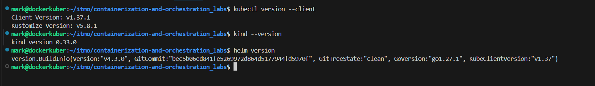

-> Все установлено и готово к работе

2. Создание и настройка кластера kind
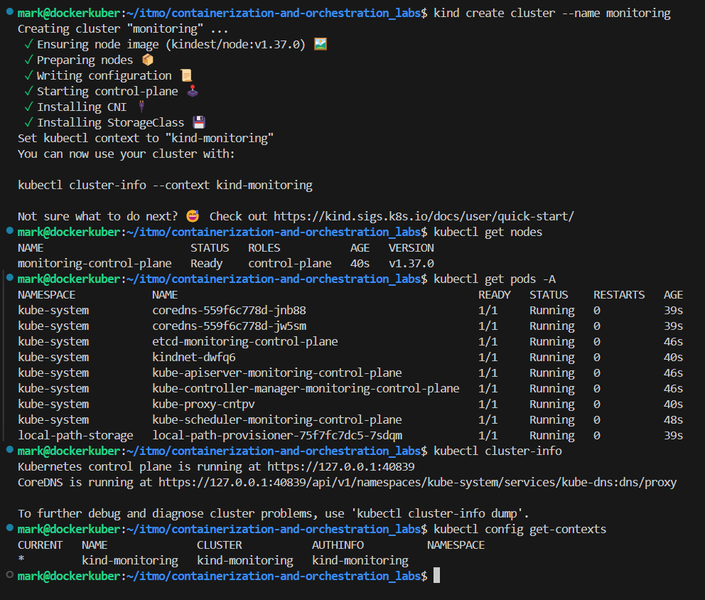

**Анализ:**
- Кластер создан 
- Кластер поднялся, он содежит одну нода Ready и кучу системных подов в kube-system
- kubectl видит кластер kind - контекст kind-monitoring

# Часть 0 - Свой сервис
1. Эндпоинты /health, /fail, /slow, /load

Создание сервиса с четырьмя эндпоинтами. Без метрик, без JSON-логов, без OTel. Просто рабочий HTTP-сервер, который можно дёргать.
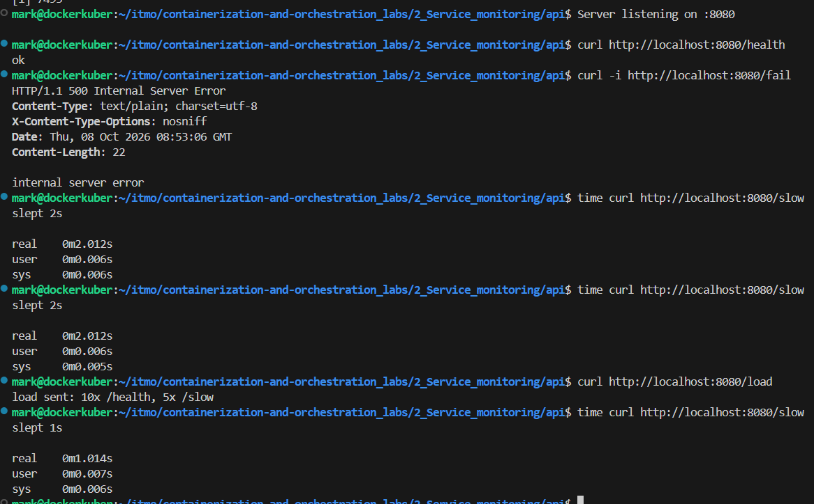

-> Все эндпоинты работают 

2. Метрики Prometheus на /metrics (RED)

1) Подкдючение библиотек
- `go get github.com/prometheus/client_golang/prometheus`
- `go get github.com/prometheus/client_golang/prometheus/promhttp`

2) Создание метрик и middleware
Проверка
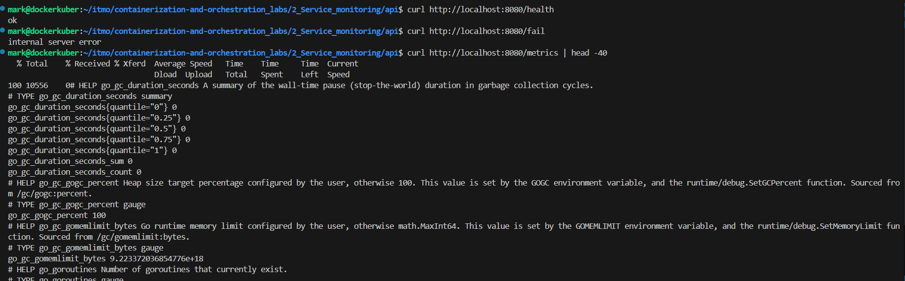

Анализ
- /health → ok, /fail → 500 — эндпоинты живы.
- /metrics отдаёт стандартные Go-метрики: go_gc_duration_seconds, go_goroutines, go_memstats_*. Это автоматически регистрирует prometheus/client_golang — полезно для мониторинга самого сервиса.

- Добавленные RED метрики

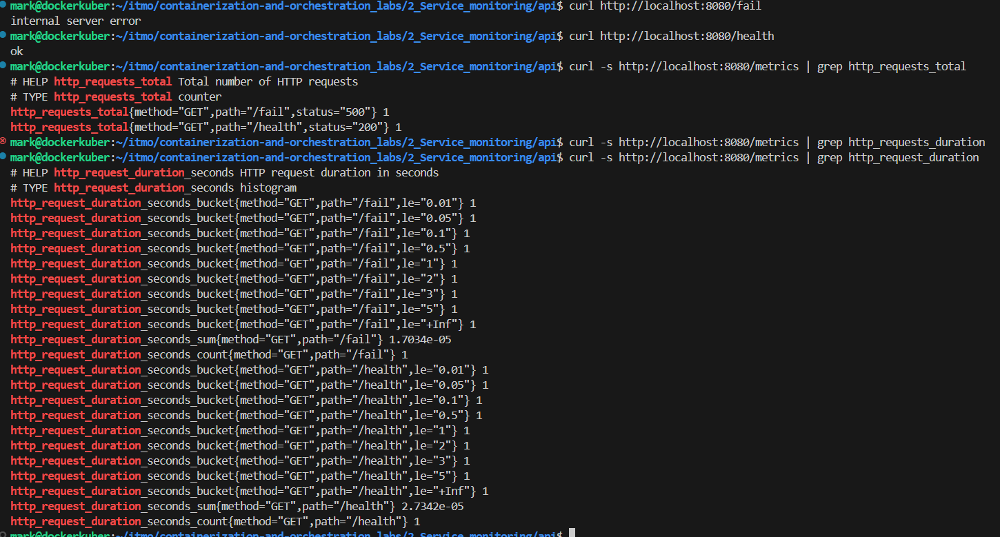

-> Работает, статистика собирается

3. JSON-логи

1) fmt.Println / fmt.Printf заменены на slog для того, чтобы формировать записи как структуры: отдельное сообщение, уровень серьёзности и набор атрибутов в виде пар «ключ-значение», и для того, чтобы системам сбора логов - Loki позволить индексировать данные и эффективно с ними работать.
2) Добаялется логирование запросов в middleware
3) Добаялется логирование бизнес-событий
4) Проверка
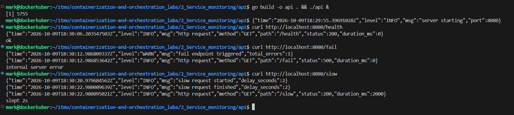
-> Всё структурно, парсится, поля корректные. Переход с обычных выводов на Json логи произошел отлично

3. Dockerfile
1) Написать Dockerfile
2) Проверка работы 
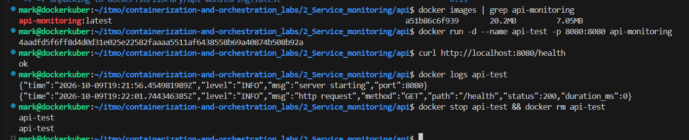

Анализ:
- Обаз создан при помощи Multi-stage: golang:1.25-alpine → scratch и статическая линковка
- Сервис рабаотет, логи собираются

4. Деплой в Kubernetes
1) kind не видит образы из локального Docker — у него свой Docker-демон внутри контейнера. Поэтому образ надо загрузить через 
    `kind load docker-image api-monitoring:latest --name monitoring`
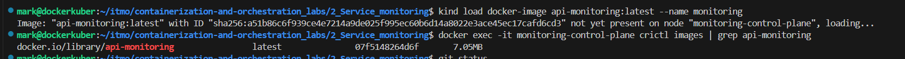

! -> теперь api-monitoring внутри клстера и kind его видит

5. Helm-чарт для сервиса
1) Создание Helm-чарт для деплоя api в k8s. В нём:
- Deployment — описывает, какой образ, сколько реплик, ресурсы.
- Service — даёт стабильный DNS-адрес для доступа к подам.
2) Описание Helm-чарта
- Chart.yaml — имя, версия, описание чарта.
- values.yaml — параметры, которые можно переопределить при установке.
- templates/deployment.yaml — шаблон Deployment
- templates/service.yaml — шаблон Service:
3) Проверка
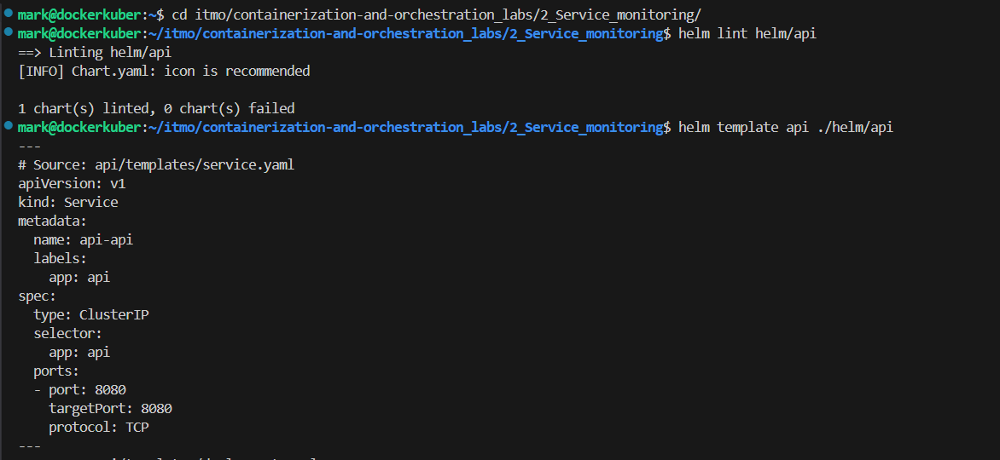
- Синтаксис чарта в норме `0 chart(s) failed`
- YAML выводятся с подставленными значениями

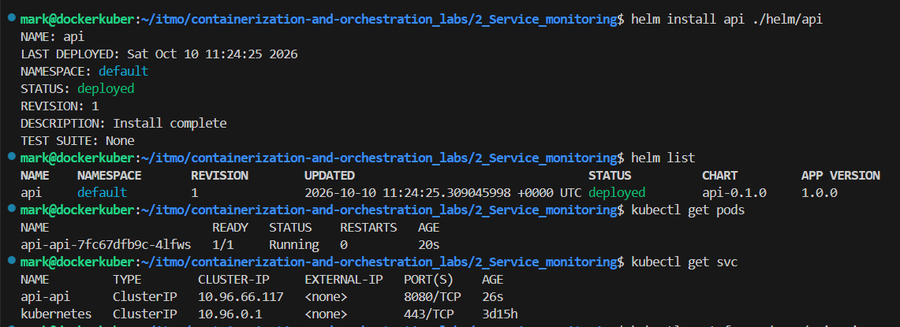
- У Helm статус "deployed" -  Успех. Релиз установлен, ресурсы созданы.
- `kubectl get pods` — под Running, 1/1 READY, 0 RESTARTS
- сервис api-api с ClusterIP

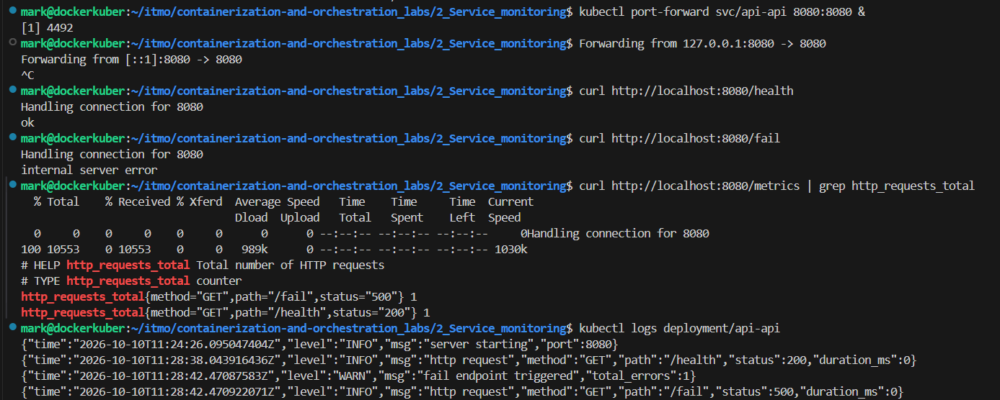
- Сервис запущен, логи собираются и выводятся в JSON формете

# Часть 1 — Метрики (Prometheus + Grafana)

1. Установка и нстройка kube-prometheus-stack 
1) Доавить репозиторий, было сделано ранее
2) Созданю отдельный namespace для мониторинга ` kubectl create namespace monitoring`, так как мониторинг — отдельный слой, не мешается с приложениями. Плюс RBAC (права) удобнее настраивать.
3) настройка values
- Будут урезаны:
    - `Стандартные дашборды` - оставлены только основыне
    - `kube-proxy, kube-etcd метрики` - отключены
    - Prometheus retention — с 10 дней до 2–3 дня
    - rometheus resources —  1+ ГБ -> 512 МБ.
    - Grafana resources — 200 МБ → 128 МБ.
    - Alertmanager resources — 100 МБ → 64 МБ.

2.  Values для kube-prometheus-stack
1) Создагние `helm/monitoring/values.yaml` — файл с настройками для kube-prometheus-stack
2) Установка 
helm install kps prometheus-community/kube-prometheus-stack \
  --namespace monitoring \
  -f helm/monitoring/values.yaml
3) Проверка
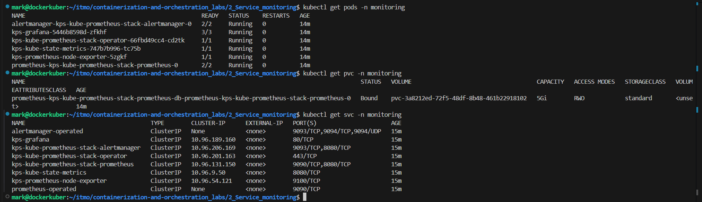

Анализ
- Все поды запущены
- Место для храния данных PVC создано
- все ClusterIP с портами.

4. ServiceMonitor для api
1) Проблема: Prometheus живёт в monitoring, а api — в default, а kube-prometheus-stack ищет ServiceMonitor'ы только в своём namespace -> api виден не будет, нужно в values поставить
- serviceMonitorSelector: {} — видеть все ServiceMonitor'ы
- serviceMonitorNamespaceSelector: {} — искать их во всех namespace.
2) Обновить релиз 
```
helm upgrade kps prometheus-community/kube-prometheus-stack \
  --namespace monitoring \
  -f helm/monitoring/values.yaml
```
3) Создание ServiceMonitor для api в отдельном файле — не в чарте kube-prometheus-stack, а в своём чарте для api, так как ServiceMonitor — часть приложения, а не мониторинга.
! ServiceMonitor создается в том же namespace, что и релиз api
4) Проверка
- Нужно было добавить имя для Service, так как ServiceMonitor требует port как строку — имя порта. Не число, потому что у Service может быть несколько портов, и Prometheus должен знать, какой именно скрейпить.
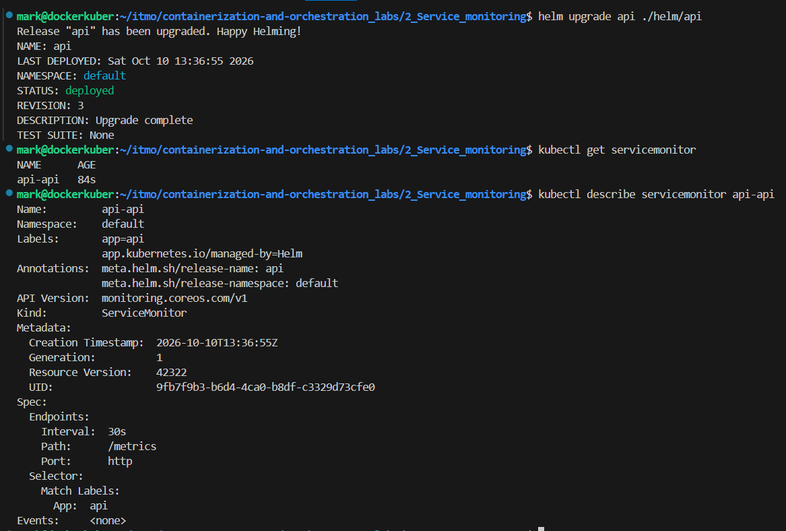
Анализ
- helm чарт обновлен и имеет версии 3
- servicemonitor создан верно 
    - Port: http
    - Path: /metrics.
    - Interval: 30s.
    - Selector: App: api

5. Проверка, что Prometheus видит цель
1) Открою Prometheus UI через port-forward
2) Проверю список всех целей
! В списке job'ов есть все системные (serviceMonitor/monitoring/kps-...), но нет serviceMonitor/default/api-api/0. Значит, Prometheus не подхватил твой ServiceMonitor.
Проблема была в том, что в kube-prometheus-stack есть скрытый параметр — serviceMonitorSelectorNilUsesHelmValues. По умолчанию он true, и это значит,что если не задать serviceMonitorSelector явно, то будет использоваьбся matchLabels: release: <имя-релиза>». (serviceMonitorSelector.matchLabels.release: kps)

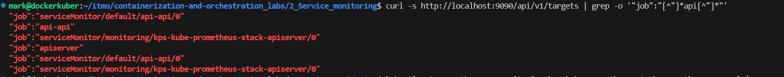
После изменений Prometheus видит цель
```
"job":"serviceMonitor/default/api-api/0"
"job":"api-api"
```

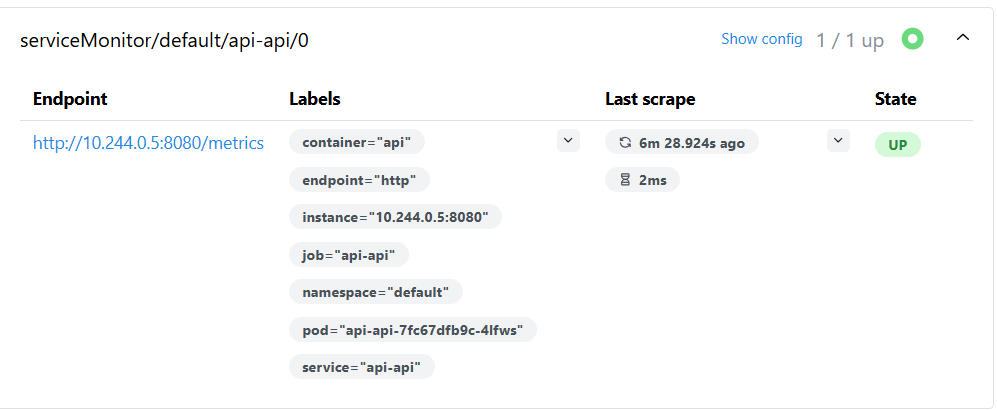
- 1 / 1 up — зелёный кружок, цель доступна.

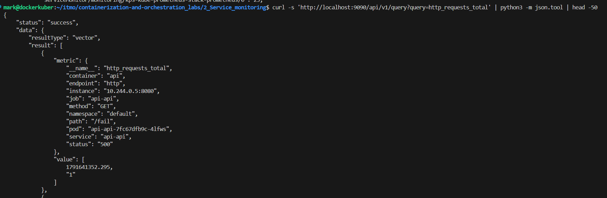
метрики собираются, JSON применился

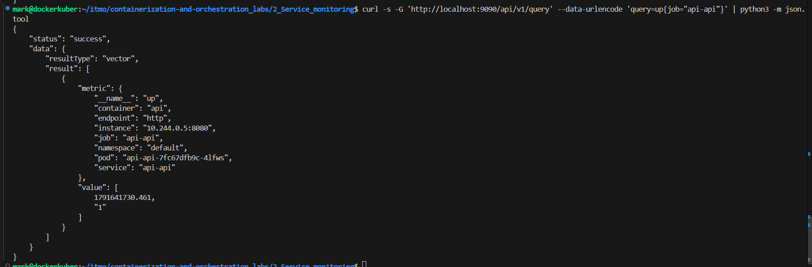
Встроенный HTTP API Prometheu в статусе "up = 1" -> target доступен. Через него можно выполнять PromQL-запросы и получать результаты в JSON. Благодря нему через браузер можно видишь графики на http://localhost:9090/graph

**-> Prometheus видит твой сервис, скрейпит /metrics, метрики с правильными labels.**

6. Подключение Grafana к Prometheus
1) kube-prometheus-stack автоматически подключает Grafana к Prometheus как datasource
2) 


