# Лабораторная работа №2 - Мониторинг сервиса: метрики, логи, трейсы
Условие: https://github.com/KeladKaal/containerization-and-orchestration/blob/main-rus/lecture-2-observability/lab.md


# Ситуация
Нужно поднять полный мониторинг одного сервиса: метрики, логи и трейсы. Метрики и логи смотришь в Grafana, трейсы — в Jaeger, алерты — в Alertmanager. Этот стек соберается один раз дальше будет переиспользоваться.

# Часть 00 — Начальная настройка
1. Нужные программы


-> Все установлено и готово к работе

2. Создание и настройка кластера kind


**Анализ:**
- Кластер создан 
- Кластер поднялся, он содежит одну нода Ready и кучу системных подов в kube-system
- kubectl видит кластер kind - контекст kind-monitoring

# Часть 0 - Свой сервис
1. Эндпоинты /health, /fail, /slow, /load

Создание сервиса с четырьмя эндпоинтами. Без метрик, без JSON-логов, без OTel. Просто рабочий HTTP-сервер, который можно дёргать.


-> Все эндпоинты работают 

2. Метрики Prometheus на /metrics (RED)

1) Подкдючение библиотек
- `go get github.com/prometheus/client_golang/prometheus`
- `go get github.com/prometheus/client_golang/prometheus/promhttp`

2) Создание метрик и middleware
Проверка


Анализ
- /health → ok, /fail → 500 — эндпоинты живы.
- /metrics отдаёт стандартные Go-метрики: go_gc_duration_seconds, go_goroutines, go_memstats_*. Это автоматически регистрирует prometheus/client_golang — полезно для мониторинга самого сервиса.

- Добавленные RED метрики


-> Работает, статистика собирается

3. JSON-логи

1) fmt.Println / fmt.Printf заменены на slog для того, чтобы формировать записи как структуры: отдельное сообщение, уровень серьёзности и набор атрибутов в виде пар «ключ-значение», и для того, чтобы системам сбора логов - Loki позволить индексировать данные и эффективно с ними работать.
2) Добаялется логирование запросов в middleware
3) Добаялется логирование бизнес-событий
4) Проверка

-> Всё структурно, парсится, поля корректные. Переход с обычных выводов на Json логи произошел отлично

3. Dockerfile
1) Написать Dockerfile
2) Проверка работы 


Анализ:
- Обаз создан при помощи Multi-stage: golang:1.25-alpine → scratch и статическая линковка
- Сервис рабаотет, логи собираются

4. Деплой в Kubernetes
1) kind не видит образы из локального Docker — у него свой Docker-демон внутри контейнера. Поэтому образ надо загрузить через 
    `kind load docker-image api-monitoring:latest --name monitoring`


! -> теперь api-monitoring внутри клстера и kind его видит

5. Helm-чарт для сервиса
1) Создание Helm-чарт для деплоя api в k8s. В нём:
- Deployment — описывает, какой образ, сколько реплик, ресурсы.
- Service — даёт стабильный DNS-адрес для доступа к подам.
2) Описание Helm-чарта
- Chart.yaml — имя, версия, описание чарта.
- values.yaml — параметры, которые можно переопределить при установке.
- templates/deployment.yaml — шаблон Deployment
- templates/service.yaml — шаблон Service:
3) Проверка

- Синтаксис чарта в норме `0 chart(s) failed`
- YAML выводятся с подставленными значениями


- У Helm статус "deployed" -  Успех. Релиз установлен, ресурсы созданы.
- `kubectl get pods` — под Running, 1/1 READY, 0 RESTARTS
- сервис api-api с ClusterIP


- Сервис запущен, логи собираются и выводятся в JSON формете

# Часть 1 — Метрики (Prometheus + Grafana)

1. Установка и нстройка kube-prometheus-stack 
1) Доавить репозиторий, было сделано ранее
2) Созданю отдельный namespace для мониторинга ` kubectl create namespace monitoring`, так как мониторинг — отдельный слой, не мешается с приложениями. Плюс RBAC (права) удобнее настраивать.
3) настройка values
- Будут урезаны:
    - `Стандартные дашборды` - оставлены только основыне
    - `kube-proxy, kube-etcd метрики` - отключены
    - Prometheus retention — с 10 дней до 2–3 дня
    - rometheus resources —  1+ ГБ -> 512 МБ.
    - Grafana resources — 200 МБ → 128 МБ.
    - Alertmanager resources — 100 МБ → 64 МБ.

2.  Values для kube-prometheus-stack
1) Создагние `helm/monitoring/values.yaml` — файл с настройками для kube-prometheus-stack
2) Установка 
helm install kps prometheus-community/kube-prometheus-stack \
  --namespace monitoring \
  -f helm/monitoring/values.yaml
3) Проверка


Анализ
- Все поды запущены
- Место для храния данных PVC создано
- все ClusterIP с портами.

4. ServiceMonitor для api
1) Проблема: Prometheus живёт в monitoring, а api — в default, а kube-prometheus-stack ищет ServiceMonitor'ы только в своём namespace -> api виден не будет, нужно в values поставить
- serviceMonitorSelector: {} — видеть все ServiceMonitor'ы
- serviceMonitorNamespaceSelector: {} — искать их во всех namespace.
2) Обновить релиз 
```
helm upgrade kps prometheus-community/kube-prometheus-stack \
  --namespace monitoring \
  -f helm/monitoring/values.yaml
```
3) Создание ServiceMonitor для api в отдельном файле — не в чарте kube-prometheus-stack, а в своём чарте для api, так как ServiceMonitor — часть приложения, а не мониторинга.
! ServiceMonitor создается в том же namespace, что и релиз api
4) Проверка
- Нужно было добавить имя для Service, так как ServiceMonitor требует port как строку — имя порта. Не число, потому что у Service может быть несколько портов, и Prometheus должен знать, какой именно скрейпить.

Анализ
- helm чарт обновлен и имеет версии 3
- servicemonitor создан верно 
    - Port: http
    - Path: /metrics.
    - Interval: 30s.
    - Selector: App: api

5. Проверка, что Prometheus видит цель
1) Открою Prometheus UI через port-forward
2) Проверю список всех целей
! В списке job'ов есть все системные (serviceMonitor/monitoring/kps-...), но нет serviceMonitor/default/api-api/0. Значит, Prometheus не подхватил твой ServiceMonitor.
Проблема была в том, что в kube-prometheus-stack есть скрытый параметр — serviceMonitorSelectorNilUsesHelmValues. По умолчанию он true, и это значит,что если не задать serviceMonitorSelector явно, то будет использоваьбся matchLabels: release: <имя-релиза>». (serviceMonitorSelector.matchLabels.release: kps)


После изменений Prometheus видит цель
```
"job":"serviceMonitor/default/api-api/0"
"job":"api-api"
```


- 1 / 1 up — зелёный кружок, цель доступна.


метрики собираются, JSON применился


Встроенный HTTP API Prometheu в статусе "up = 1" -> target доступен. Через него можно выполнять PromQL-запросы и получать результаты в JSON. Благодря нему через браузер можно видишь графики на http://localhost:9090/graph

**-> Prometheus видит твой сервис, скрейпит /metrics, метрики с правильными labels.**

6. Подключение Grafana к Prometheus
1) kube-prometheus-stack автоматически подключает Grafana к Prometheus как datasource
2) Проверка
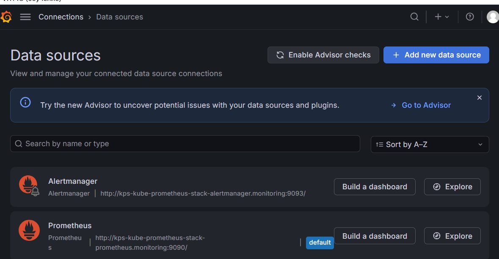
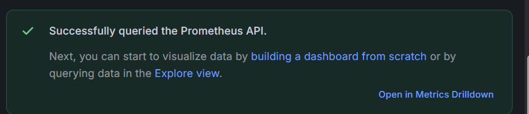
-> Grafana доступна, datasource - Prometheus b он работает

7. RED-дашборд
1. Создание через панелей для Дашборда через UI
1) Пролбемы:
- Нестабильность соединения. kubectl port-forward плохо работает с WebSocket-соединениями, которые Grafana 
использует для live-обновлений. Туннель периодически рвётся с ошибкой:
   "error forwarding port 3000 ... connection reset by peer"

Решение:
- Использовать nohup + лог в файл вместо интерактивного запуска:
  nohup kubectl port-forward -n monitoring svc/kps-grafana 3000:80 \
    --address='0.0.0.0' > /tmp/pf-grafana.log 2>&1 &
- Пробросить порт через VS Code Port Forwarding (вкладка Ports) — это 
  стабильнее, чем kubectl port-forward напрямую.
- При обрыве — F5 в браузере или перезапуск port-forward.
2) Изначально лимит памяти Grafana был 256Mi — она постоянно падала с OOMKilled(10 рестартов за час). При перезапуске пода терялись несохранённые изменения дашборда.

Решение:
- Увеличить лимиты Grafana до 512Mi в values.yaml.
- После этого под стабилизировался, рестарты прекратились.

-> Для учебного стека в kind kubectl port-forward + VS Code Ports — приемлемое решение. В проде для Grafana используют Ingress или LoadBalancer — они не зависят от локального туннеля.


Первая панель RPS
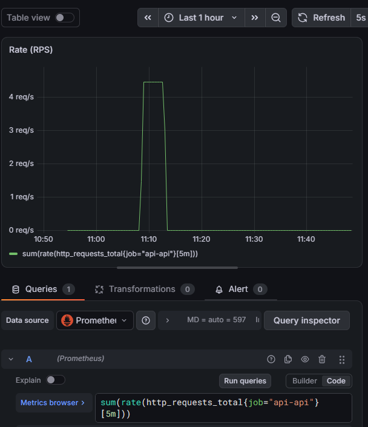
Вторая панель ERROR
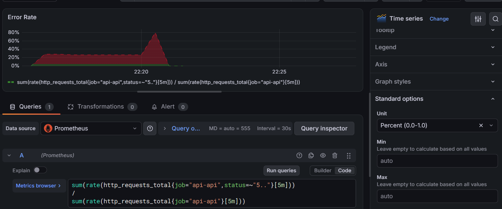
Третья панель p95
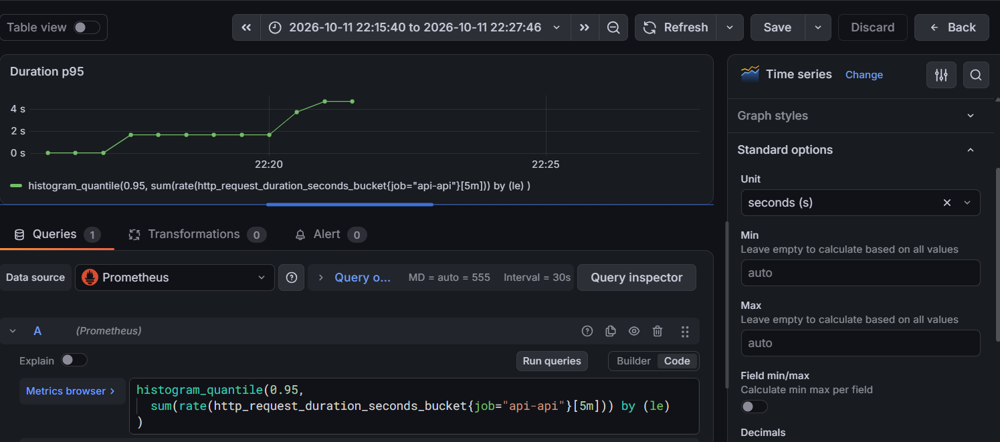

Состояние до 
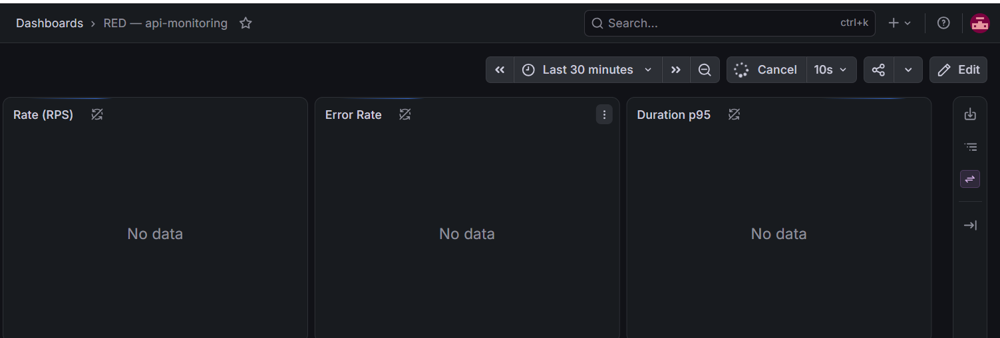

Дернул данные

Анализ
- Rate (RPS) — поднимается с 0 до 0.3 req/s — это мои запросы. 
- Error Rate — прыгает с 0 до 27% — это /fail.
- Duration p95 — взлетает с 0 до 1.6 сек — это /slow.
-> RED-дашборд полностью работает. Все три метрики реагируют на эндпоинты, как и требовалось в задании.

После ручной сборки панелей в UI:
1. Экспортировал JSON дашборда
2. Сохранил в helm/monitoring/dashboards/RED.json.
3. Создал ConfigMap с меткой, которую подхватывает Grafana:
   kubectl create configmap red-dashboard -n monitoring \
     --from-file=red.json=.../red.json
   kubectl label configmap red-dashboard -n monitoring grafana_dashboard=1
4. Grafana sidecar автоматически находит ConfigMap'ы с этой меткой 
   и создаёт дашборды при старте.
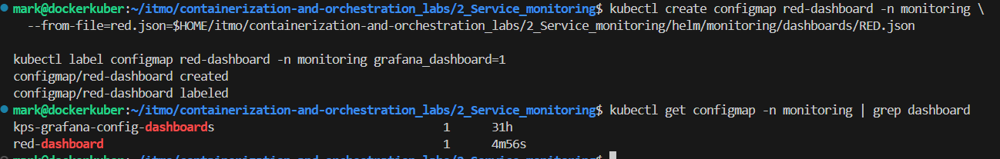

# Часть 2 — Логи (Loki + Grafana)
1. Добавь репозиторий Grafana
1) 
`helm repo add grafana https://grafana.github.io/helm-charts
helm repo update
`
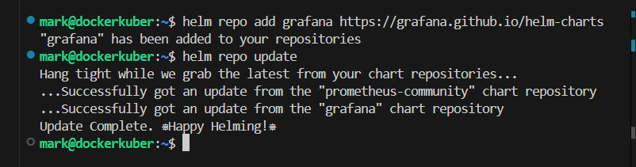

2) 
Проверка чартов
`helm search repo grafana/loki`
Вывело
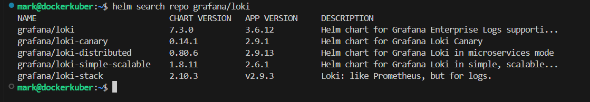

3) Для работы выберу loki, так как это современный чарт, поддерживает режимы: SingleBinary, SimpleScalable, Distributed. Для лабы буду использовать SingleBinary (всё в одном поде).

2. Реализация
1) Создал `values.yaml` для натсройки Loki
2) Установка и проверка
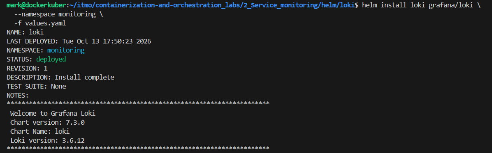
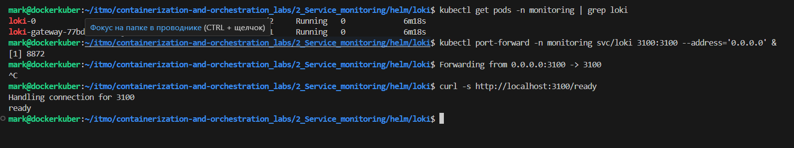
-> Поды запщены и Loki готов к работе

3. Grafana Alloy
1) Создал `values.yaml` для натсройки
2) Установка и проверка
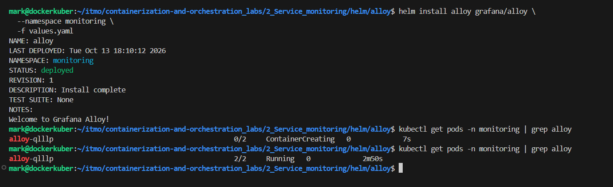
Установлен, поды запущены

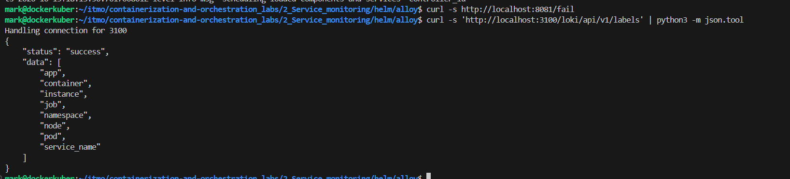
Всё, что настраивалось в `discovery.relabel` — на месте. Alloy собирает логи и отправляет в Loki.

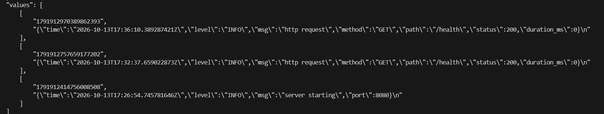
-> Логи api дошли до Loki, цепочка работает: api → stdout → containerd → Alloy → Loki.


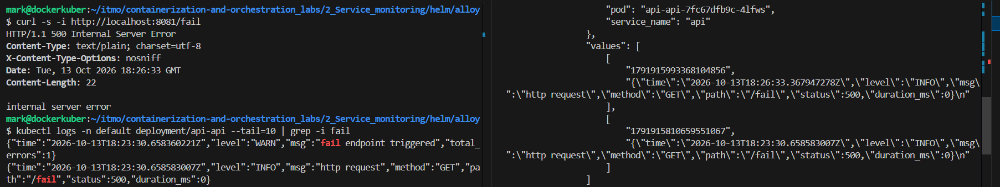
Собитие fail было залогировано

4. Подключение Loki к Grafana
1) Идем `ttp://localhost:3000`
2) Во вклдке "Data sources" добавить Loki и уыидеть `Data source successfully connected.`
3) Проверка
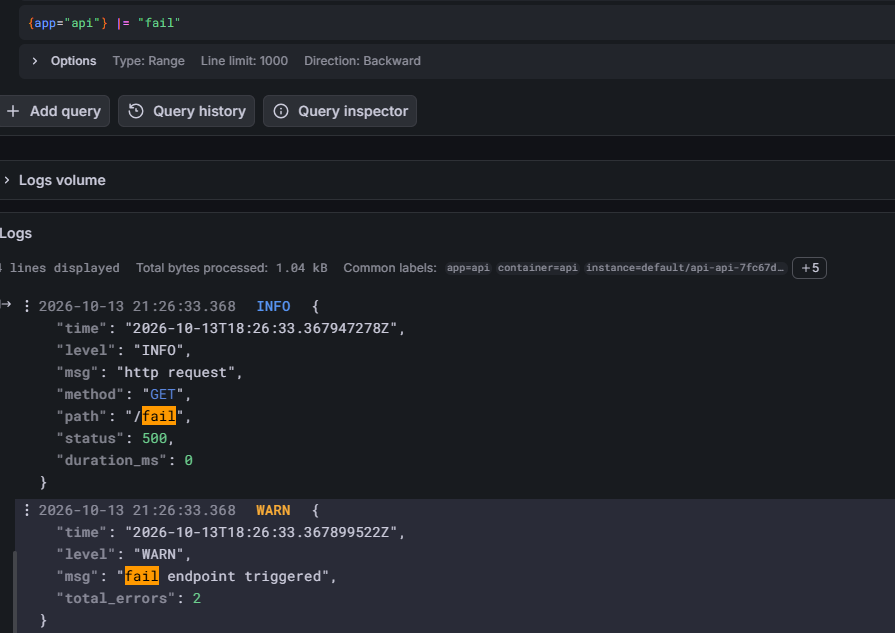
Анализ
- JSON разложен по полям — time, level, msg, path, status, total_errors
- Уровни подсвечены — INFO, WARN
- Фильтр работает — видим только логи /fail

-> api → stdout → containerd → Alloy (DaemonSet) → Loki → Grafana Explore.

# Часть 3 — Трейсы (OpenTelemetry + Jaeger)
1. Добавление OTel в код api
1) Подключил библиотеки
- otel — API для создания спанов.
- otel/sdk — реализация SDK (TracerProvider, экспортёры).
- otlptracegrpc — экспортёр по OTLP/gRPC (в Jaeger).
- otelhttp — автоматическая инструментация HTTP-сервера.
2) Поменян фалй для запуска сервиса api
- Инициализировал OTel `initTracer`
- Обернул все хендлеры в `otelhttp.NewHandler`
- В `/slow` — вложенный спан `slow-op`
-  `/fail` — пометить спан как ошибку
- В логи добавить `trace_id` — через slog.Handler с OTel
3) Проверка
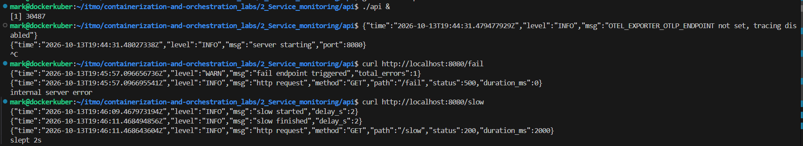
-> JSON-логи идут, но OTel работает в no-op режиме `OTEL_EXPORTER_OTLP_ENDPOINT not set, tracing disabled`: спаны создаются локально, никуда не уходят. Поэтому в логах нет trace_id.
! Сначала Поднять Jaege, чтобы был endpoint, куда слать трейсы и потом добавить OTEL_EXPORTER_OTLP_ENDPOINT в values api

2. Jaeger
1) Добавил репозиторий 
`helm repo add jaegertracing https://jaegertracing.github.io/helm-charts`
2) Создал `values.yaml` для натсройки Jaeger
3) Установка и проверка
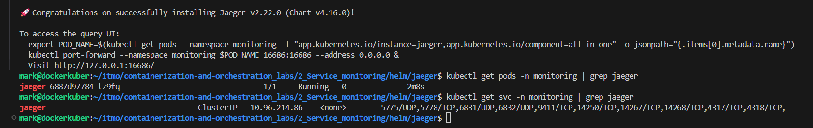
Анализ
Jaeger работает
Один сервис jaeger со всеми портами:
- 4317 — OTLP/gRPC
- 4318 — OTLP/HTTP
- 16686 — UI
- 14250, 14268 — Jaeger native
- Endpoint для `api: jaeger.monitoring.svc.cluster.local:4317`

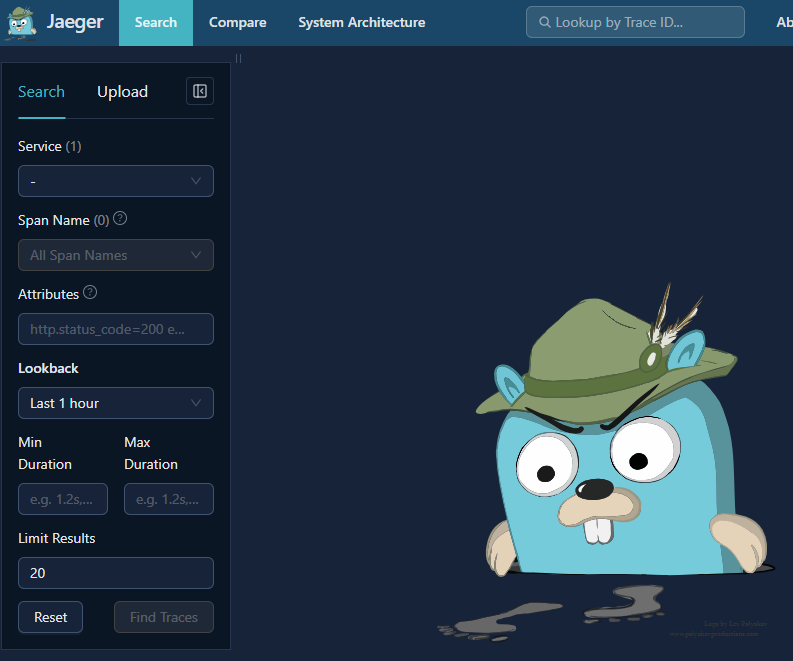
Jaeger UI тоже тоступен

3. Добавление trace_id 
1) в helm/api/templates/deployment.yaml нужно добавить env
`
env:
  - name: OTEL_EXPORTER_OTLP_ENDPOINT
    value: "{{ .Values.otel.endpoint }}"
`
2) Обновил values у сервиса, чтобы добавить endpoint параметризуемо
`
otel:
  endpoint: "jaeger.monitoring.svc.cluster.local:4317"
`

4. Подготовка
1) После изменения main.go был пересобран Dockerfile
`docker build -t api-monitoring:latest .`
2) Загрузка в kind:
`kind load docker-image api-monitoring:latest --name monitoring`
3) Обновление Helm-релиза
`helm upgrade api ./helm/api`
- Перезапустить под, чтобы подхватил новый образ
`kubectl rollout restart deployment/api-api -n default`
- Проверка пода
`kubectl get pods -n default | grep api` -> status `Running`
4) Проверка логов
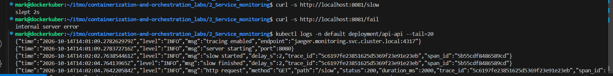
Логи с trace_id и span_id

- Проврека связи
  - В Grafana выполнил запрос `{app="api"} |= "trace_id"` и поулчаю `trace_id = 5c6197fe23851625d5369f23e91e23eb` /slow запроса
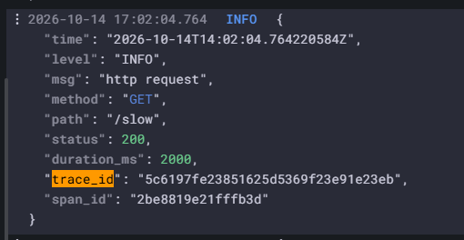  
- вставляю в Jaeger `trace_id` и нахожу тот же трейс.
  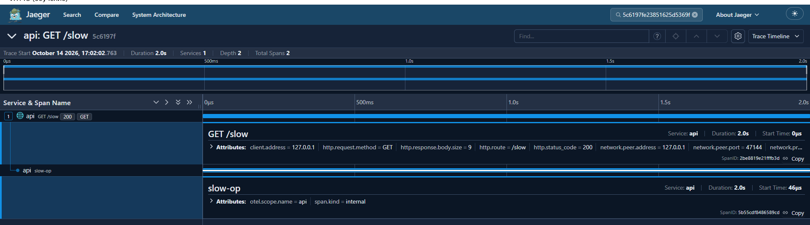 
-> Связь работает, откроется тот же трейс, что я видел из Grafana — GET /slow и slow-op. Только теперь я попал в него из лога.

- Провнрка Jager
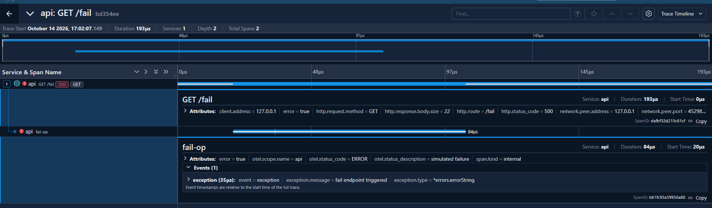
Анализ

- GET /fail — с красным статусом 500
- fail-op — красный ошибочный спан
- Depth 2, Total Spans 2

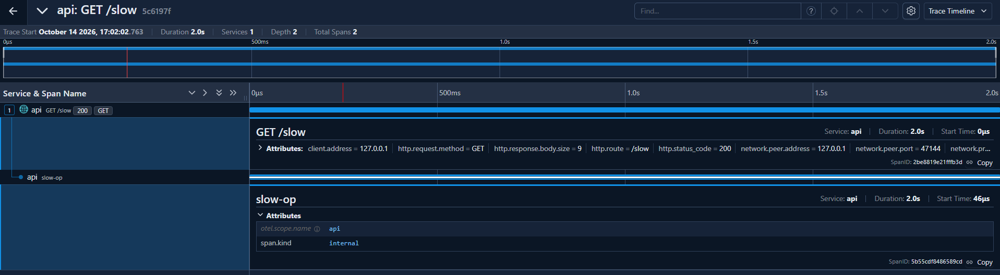

- GET /slow — корневой, 2.0s
- slow-op — вложенный, ~2.0s (медленная операция внутри)
- Depth 2, Total Spans 2