# Лаба 3 — Соборка платформы для shop

## Условие
https://github.com/KeladKaal/containerization-and-orchestration/blob/main-rus/lecture-3-kubernetes-control-plane/lab.md

## Ситуация
В реальном кластере кто угодно может задеплоить сервис без лимитов ресурсов, с чужим образом или без нужных меток — и это тихо доедет до прода, потому что никто не проверяет вручную каждый YAML. База данных требует ручной эксплуатационной рутины — разворачивание, восстановление после сбоя пода — этим приходится заниматься инженеру, а не системе. А когда падает control plane, никто заранее не знает, что из приложения упадёт, а что продолжит работать, — это выясняют уже во время инцидента.

Эта лаба закрывает все три проблемы разом. Сначала задаются ограждения политикой — кластер физически не принимает нарушающие правила деплои, и ревьюить каждый YAML руками не нужно. Затем пишется Helm-чарт для shop (api, worker, postgres), который соответствует этим ограждениям, а postgres заводишь через оператора, который берёт эксплуатацию базы на себя. И на живом кластере проверяешь руками, что переживает падение control plane.

# Часть 0 — Сервисы

## 1. Написание кода
## 2. Создание образов, копировние в kind
## 3. Проверка
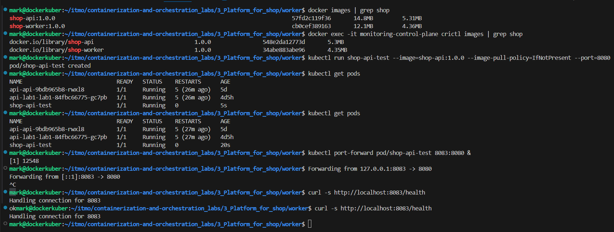
- Образы созданы и добавлены в kind
- Под успешно запустился `shop-api-test Running `
- endpoint `/health` отработал как нужно 
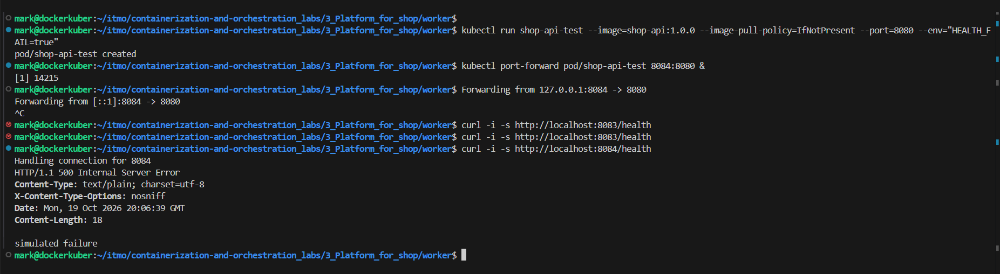
- endpoint `/health` с выставленной переменной окружения, отвечает кодом 500 - отработал как нужно
! Остальной функционал не проверить, так как еще рано

# Часть 1 — Ограждения на кластер

## 1. Установка Kyverno
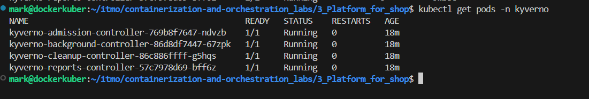
- Kyverno установлен, все 4 контроллера работают:
    - admission-controller — принимает решения (пропустить или отклонить деплой)
    - background-controller — проверяет существующие ресурсы
    - cleanup-controller — чистит мусор
    - reports-controller — собирает отчёты о нарушениях

## 2. Ограждения на кластер
!! У Kyverno по умолчанию политики работают в режиме Audit (просто логируют нарушение). В ларбораторной нужно, чтобы они физически блокировали деплой. Для этого в каждой политике нужно установить `validationFailureAction: Enforce.`
1. Полититки будут расписаниы в  `policies/policies.yaml`
- № 1 - Обязательные лимиты ресурсов
! Я использую мягкое ограничение - главное, чтобы поле memory вообще было заполнено и не было пустым. В продакшене эта политика была бы ужесточена до конкретных диапазонов (например, memory < 2Gi), чтобы предотвратить не только отсутствие лимитов, но и их неадекватно высокие значения, которые могут привести к вытеснению других подов.

- № 2 - Только доверенный реестр / локальные образы (Разрешаются только образы, начинающиеся на 'shop-', чтобы запретить тянуть что угодно из интернета)
- № 3 - Обязательные метки, чтобы понимать, чей это сервис
- № 4 - Запрет privileged-контейнеров для безопасности
В 1 раз я проверял на то, что privileged со значением false, но есля янво не прописывать, то постоянно срабатвает это ограничение. Поэтому стал проверять на отсутствие `true`
- № 5 - Запрет тега 'latest для того, чтобы не было проблем с воспроизводимостью

Дополнительно были добавлены
- № 6 - Запрет hostPath (защита от побега)
- № 7 - Запрет hostNetwork / hostPID (защита от доступа к сети/процессам хоста)
- № 8 - Ограничение по количеству реплик, чтобы не съесть весь кластер

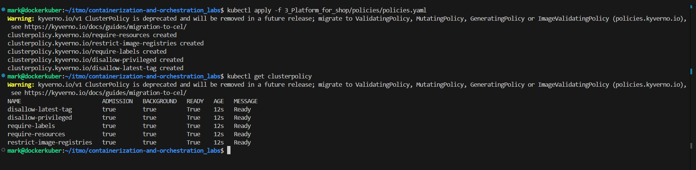
-> Политики созданы и готовы к огранивать

2. Подготовка плохих манифестов
Они лежат в `raw-manifests/`
Было написано 5 плохих манифестов
- № 1 - не указаны лимиты
- № 2 - используется чужой образ
- № 3 - не используюстся метки
- № 4 - используется флаг `privileged`
- № 5 - испольхуется тег версии `latest`

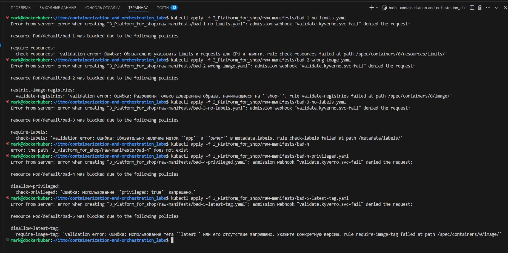
-> Применение плохих манифестов запрещено

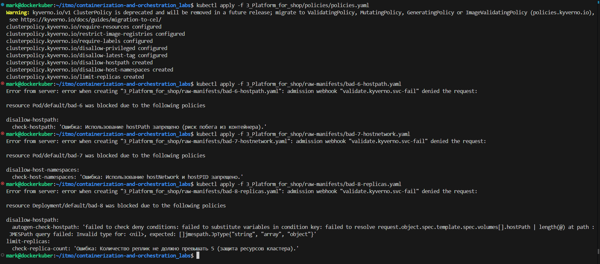
Дополнителные политики создались и завпращают неправильнное испольжлвание

# Часть 2 — Чарт api и worker
1. Создание чарта `shop`
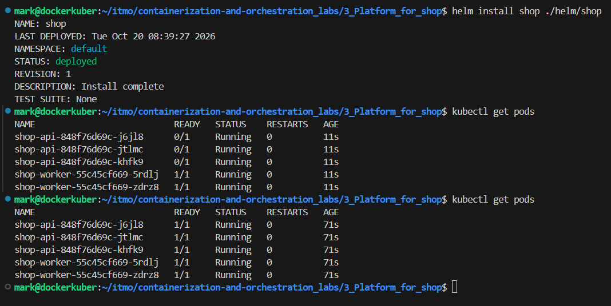
-> Чарт создан, поды запущены в нужном колличестве

2. Проверки
- `Самовосстановление` 
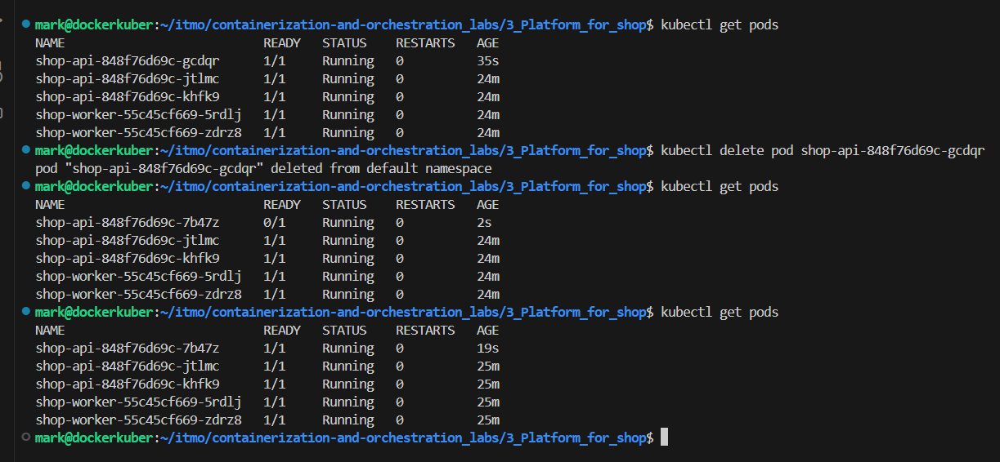
-> при удалении Deployment controller заметил, что фактическое число подов - 2 отличается от желаемого - 3, и создал новый

- `Масштабирование` 
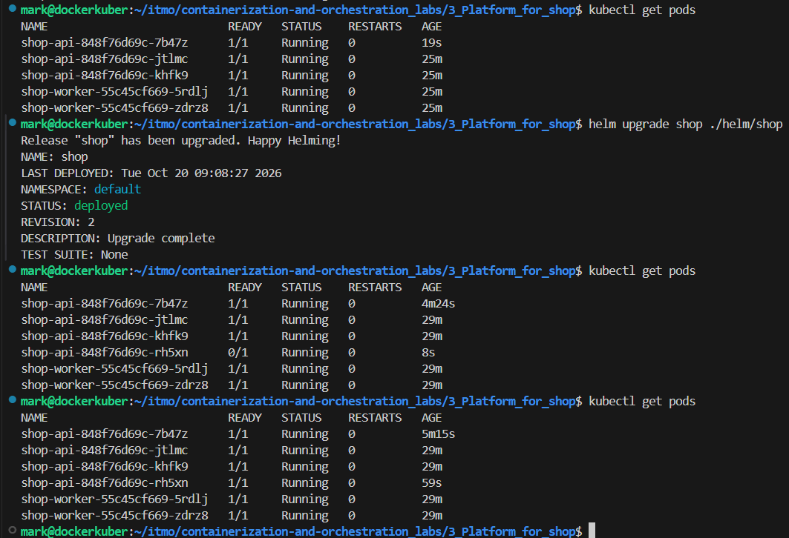
Число подов shop-api увеличил с 3 до 4

- ` Rolling Update`
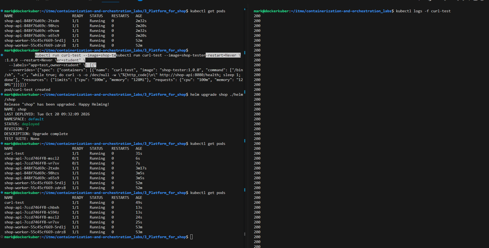
В момент `helm upgrade shop ./helm/shop` был поменян тег на новый у подов `shop-api`
Анализ
- Поды обновлялись постепенно только у `shop-api` (видно, что сначала появились новые 7ccd... с 0/1, а старые 848f... еще жили), а `shop-worker` не изменялись, так как их тег был не тронут
- url-test непрерывно получал 200
- Ни один запрос не провалился.
Это значит, что Kubernetes Service умно переключил трафик на новые поды только после того, как они прошли readinessProbe

- Закатывается сломанная версия
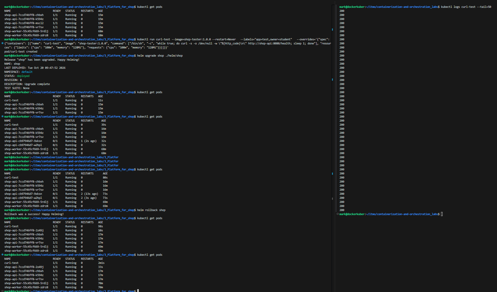
! В момент `helm upgrade shop ./helm/shop` HEALTH_FAIL стал "true"
Анализ:
- curl-test показал 50 успешных запросов (200).
- При закатке сломанной версии старые поды (7ccd...) остались работать, а новые (cb97...) застряли в 0/1 из-за рестартов (liveness probe убивал их, потому что /health отдавал 500).
- Я выполнил `helm rollback`, и кластер вернулся в норму.

# Часть 3 — Postgres через оператора
## 1. Установка CloudNativePG
! Пытался установить и Kyverno блокировал установку, потому что его Deployment (в namespace cnpg-system) не имеет меток и использует образ не на shop-. Поэтому системные namespace'ы (kube-system, monitoring, cnpg-system) всегда исключают из таких политик, иначе инфраструктурные компоненты просто не смогут запуститься. Нужно добавить исключение (exclude) для cnpg-system (и заодно для kube-system и monitoring, чтобы не сломать Grafana/Prometheus) во все наши политики.
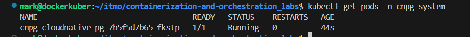
Установка CloudNativePG прошла успешно под имеет статус `Running`

## 2. Создание манифеста базы данных
1. Манифест находится по пути `helm/shop/templates/postgres-cluster.yaml`
! Так как Kyverno проверяет и поды, которые создает оператор. Поэтому нужно передать правильные метки и ресурсы прямо в манифест Cluster
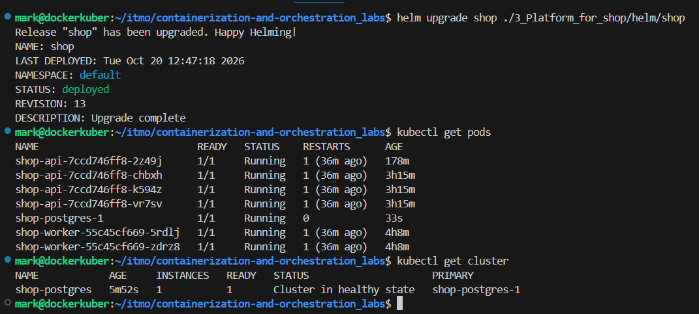
-> Под БД поднялся и работает, статус базы - `Cluster in healthy state`
! В процессе поднятия пода я столкнулся с проблемой, что строгие правила безопасности (Kyverno) начали блокировать системные компоненты, которые сами пытались развернуть базу данных:

- Kyverno заблокировал самого оператора.
Оператор CloudNativePG — это системный сервис. Он не имеет меток (app, owner), использует свой образ и не всегда указывает лимиты. Созданные правила заблокировали его установку.

- Kyverno заблокировал образ базы данных.
Оператор попытался создать под с базой, используя официальный образ ghcr.io/cloudnative-pg/postgresql. Правило «только доверенный реестр (начинающийся на shop-)» заблокировало его.

- Kyverno заблокировал создание диска (PVC).
В kind диски создает системный компонент local-path-provisioner. Чтобы сделать диск, он запускает «helper-под» с hostPath (чтобы примонтировать папку с хоста). Правила про hostPath и метки заблокировали и его!

Решение
- Добавили исключения (exclude) в Kyverno.

- Обошел баг kind load.
kind load не смог загрузить мультиархитектурный образ Postgres. Пришлось выполнить docker save (сохранили образ в файл) -> передали этот файл внутрь ноды kind -> импортировали через ctr напрямую в containerd.

- Переупаковали образ под нужным именем.
Переделан docker tag для образа Postgres, чтобы он назывался shop-postgres:15.5 и прошел правило доверенного реестра.

## 3. Проверка
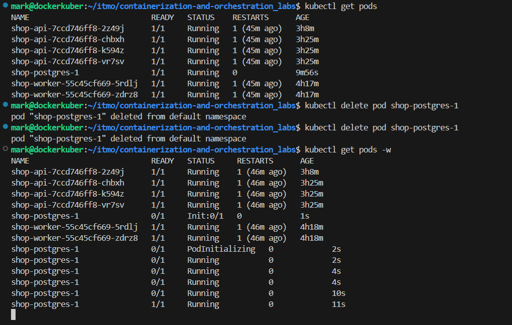
Самовосстановление работает

блок spec — желаемое состояние (то, что описано в Helm-чарте). Строки:
- imageName: shop-postgres:15.5 — переопределенный образ, чтобы пройти Kyverno.
- inheritedMetadata: labels: app: shop-postgres, owner: student — прокинутые метки в поды базы, чтобы они тоже прошли политики.

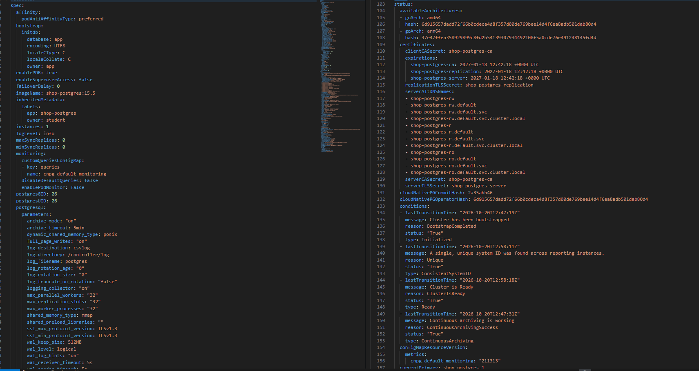
Сравнение Controller-Manager и Оператора (CloudNativePG):
- Controller-manager (встроенный в Kubernetes) — это «универсальный менеджер». Он следит за базовыми объектами (Deployment, ReplicaSet, Service). Он понимает только базовую логику: «если в спецификации написано 3 реплики, а работает 2 — создай еще одну». Он ничего не знает о внутренностях приложения (например, о PostgreSQL).
- Оператор (CloudNativePG) — это специализированный контроллер. Он расширяет Kubernetes с помощью CRD (Custom Resource Definition), добавляя новый тип объекта — Cluster. Оператор знает предметную область (базы данных).

В чем разница на практике:
- Spec (в Cluster) описывает наши желания: 1 инстанс, образ shop-postgres:15.5, размер диска 1Gi.
- Status (в Cluster) — это то, что оператор делает и видит изнутри. Он показывает фазу (`Setting up primary`, `phase: Cluster in healthy state`), готовность, текущие IP-адреса, статус репликации.

Встроенный controller-manager просто перезапустил бы упавший под postgres, но не смог бы правильно провести инициализацию базы (initdb), настроить отказоустойчивость, сделать бэкап или переключить трафик на реплику. Именно поэтому для баз данных (и других сложных систем) используют операторы, они берут на себя всю «эксплуатационную рутину», которую в обычном K8s пришлось бы делать инженеру руками.
