# Лаба 4 — SLA критического пути под перегрузкой

## Условие 
https://github.com/KeladKaal/containerization-and-orchestration/blob/main-rus/lecture-4-scheduling-resources/lab.md

## Ситуация
В shop есть критический путь — оформление заказа (api → postgres) — и второстепенная фоновая нагрузка вроде ночной аналитики, которой под давлением можно пожертвовать. Вся настройка идёт через Helm-чарт shop из Лабы 3: affinity, приоритеты, ресурсы, PodDisruptionBudget — значения и шаблоны чарта, а не разовые kubectl-патчи. Руками только наблюдаешь и провоцируешь нагрузку.

Числа для requests/limits критического пути не придумываются — их даёт krr (Kubernetes Resource Recommender) по реальному потреблению из Prometheus.

# Часть 0 — Сервис batch

## 1. Написание кода для сервиса
## 2. Dockerfile и сборка образа (пока без kind, так как нового кластера еще нет)
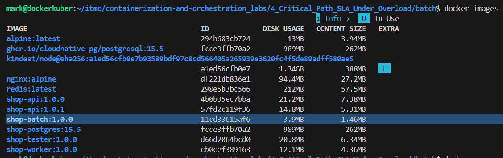
Образ создан

# Часть 1 — Выбор механизма разнесения

## 1. Выбор
- podAntiAffinity (Анти-аффинити) (requiredDuringScheduling + topologyKey): Это классический метод, который жестко разносит поды.Говоришь планировщику: «Не ставь мой под на ноду, если на ней уже есть под с такой-то меткой». У нее есть уровни (required — жестко, preferred — мягко). Это сработает, только если нод много. Если нод 2, а реплик 4 — две реплики останутся в Pending, потому что им физически некуда встать

- topologySpreadConstraints (Ограничения топологии): более умный механизм. Он не запрещает ставить поды на одну ноду, если места больше нет, а просто следит, чтобы перекос перекос между зонами не больше одного пода.

Я выберу для лабораторной `topologySpreadConstraints`? Потому что он решает проблему «асимметрии» при масштабировании. Если будет 3 ноды и 4 реплики, antiAffinity просто раскидает их как получится. А topologySpread сделает так, чтобы разница в количестве подов между нодами была не больше 1 (maxSkew: 1).

## 2. Реализация
1. Перенес структуру чарта из 3 лабы
1. В файлик для управления репликамидобавлена доп настройка `spreadMechanism: "topologySpread"` для api
2. В шаблон для yaml файла был добавлен выбор параметр выбора между podAntiAffinity и topologySpreadConstraints
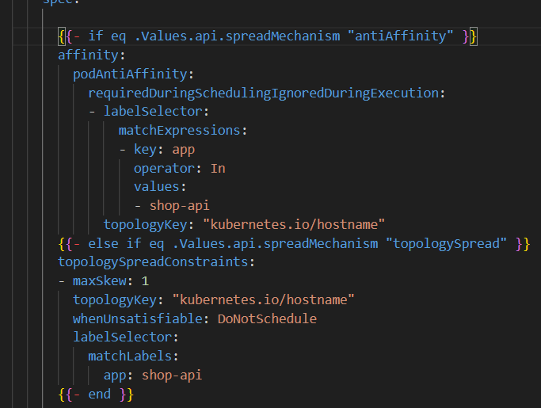

# Часть 2 — Тесная площадка

## 1. Создание 2-нодового кластера kind
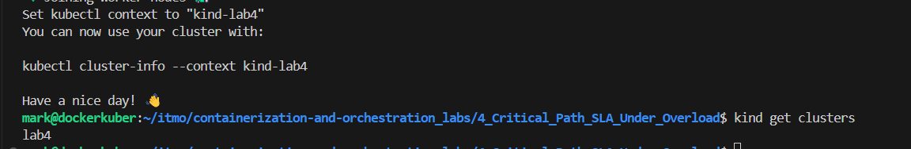
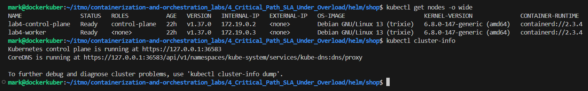
Кластер создан и в нем две ноды `control-plane` и `worker`

## 2. Снятие taint
Был снят taint с control-plane, так как без `kubectl taint nodes lab4-control-plane node-role.kubernetes.io/control-plane:NoSchedule-` поды api не смогли бы планироваться на control-plane, и spread был бы не 2 + 2, а 0 + 4.

## 3. Установка инфраструктуры
### 3.1 Kyverno + policies
Устанавка Kyverno и политик
- Сюда переносяттся настрйоки политик из лабы 3 
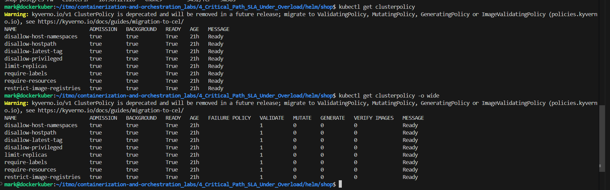
Правила созданы и готовы к работе 

## 3.2 CNPG (postgres-кластер)
`helm upgrade --install cnpg cnpg/cloudnative-pg -n cnpg-system --create-namespace`
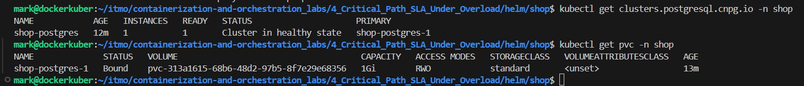
-> Cluster Ready, PVC создан

### 3.3. kube-prometheus-stack (мониторинг)
Будет использоваться только такойже стек, что и в лабе 2
```
helm upgrade --install kps prometheus-community/kube-prometheus-stack \
  -n monitoring --create-namespace -f helm/monitoring/values.yaml
```

## 4. Сборка и загрузка образов в kind
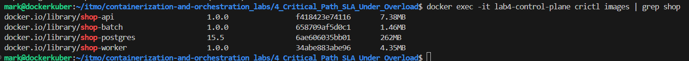
Образы попали в кластер

## 5. Добавление шаблона batch в чарт shop
В чарт добавлен templates/batch-deployment.yaml + блок batch в values.yaml

## 6. Деплой чарта shop
`kubectl create namespace shop`
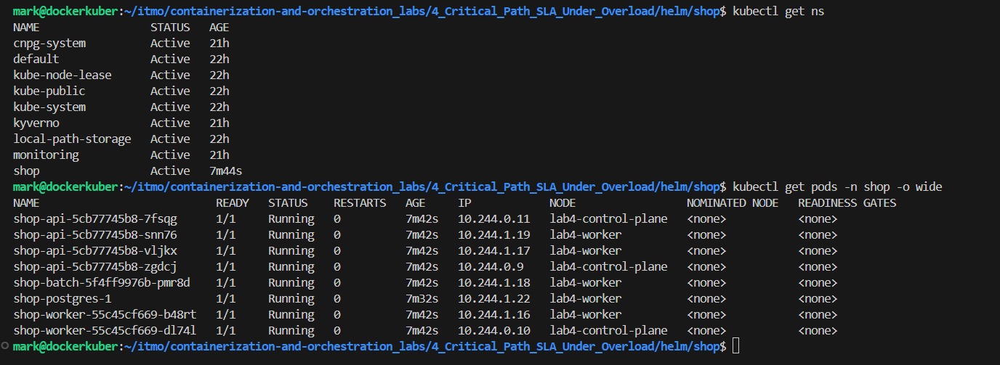
-> 8 подов shop, shop-api раскидан 2+2 по нодам.

## 7. Проверки состояния
### 7.1 Helm-релизы (вся инфраструктура)
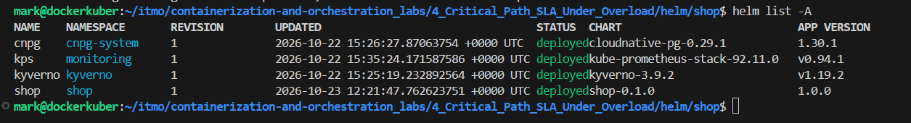
-> 4 релиза: cnpg, kps, kyverno, shop

### 7.2 Сервисы
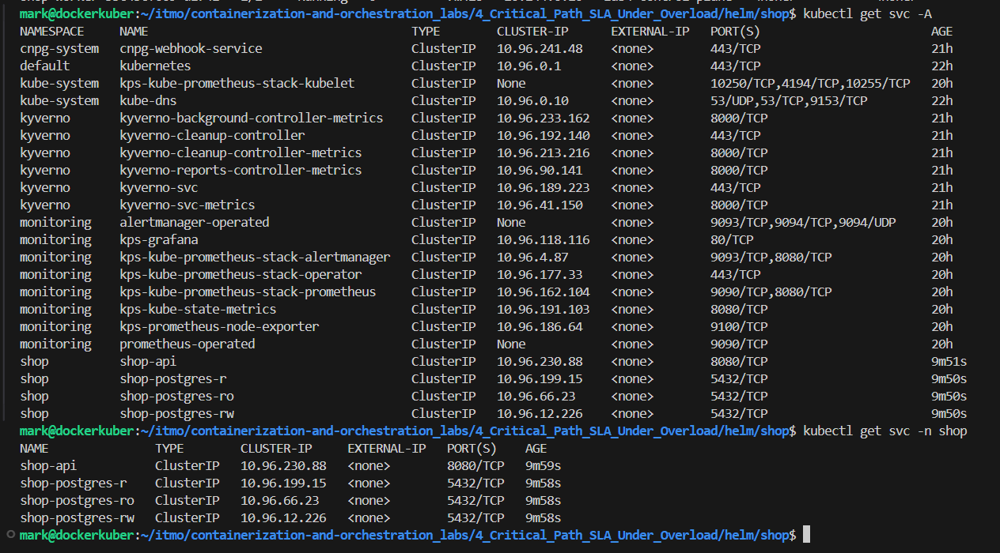

### 7.3 Мониторинг (Prometheus/Grafana/Alertmanager)
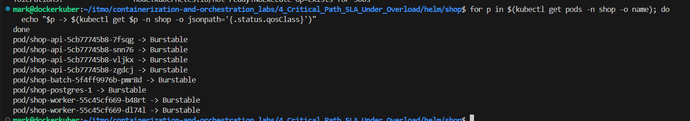
-> видно, что shop-api ServiceMonitor есть и все инструменты готовы к работе

### 7.4 По поводу request/limits 
В Kubernetes класс QoS Guaranteed (Гарантированный) присваивается поду только в том случае, если requests равны limits строго для CPU и для памяти.
Если не поставить CPU limit (следуя лучшей практике с лекции), под получит класс Burstable (как batch). А в Части 7 нам как раз нужно, чтобы api (Guaranteed) не выселялся, а batch (Burstable) выселялся первым. Поэтому в рамках этой лабы CPU limit будут утсановлены так, чтобы получить статус Guaranteed и выполнить задание.
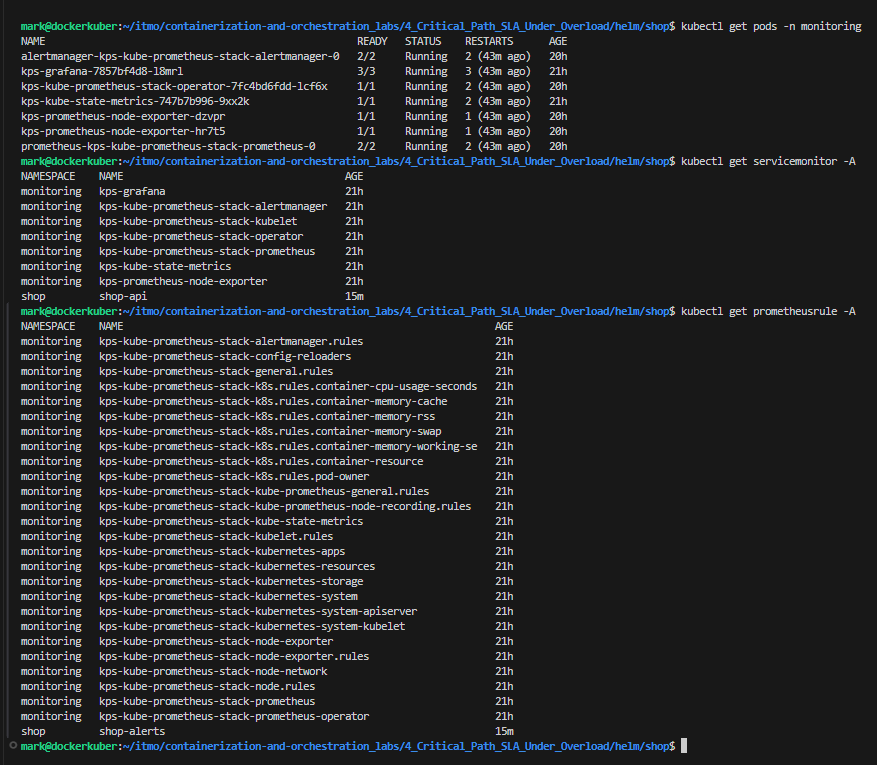
! все Burstable (в части 5 сделаем api/postgres Guaranteed).

# Часть 3 — Реальные числа вместо угадывания
`krr (Kubernetes Resource Recommender)` — утилита от Robusta, которая читает исторические метрики из Prometheus и рекомендует requests/limits на основе реального потребления (обычно 95-й перцентиль). Если контейнер никогда не потреблял больше 50m CPU, зачем держать requests 200m?

## 1. Установка krr
Использваолся docker image
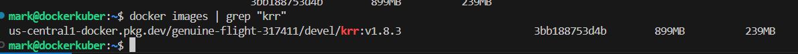
-> Успешно скачан

## 2. Проброс Prometheus
## 3. Проброс api + нагрузка 
Дергааю endpoint `http://localhost:8081/order`, 3200 раз
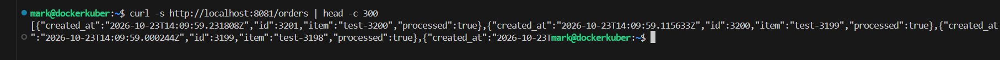
-> Все запросы выполнились
## 4. Запуск krr как Python-скрипт
```
docker run --rm -it --network host -e LANG=C.UTF-8   -v ~/.kube:/root/.kube   us-central1-docker.pkg.dev/genuine-flight-317411/devel/krr:v1.8.3   python krr.py simple -p http://localhost:9090 -n shop
```
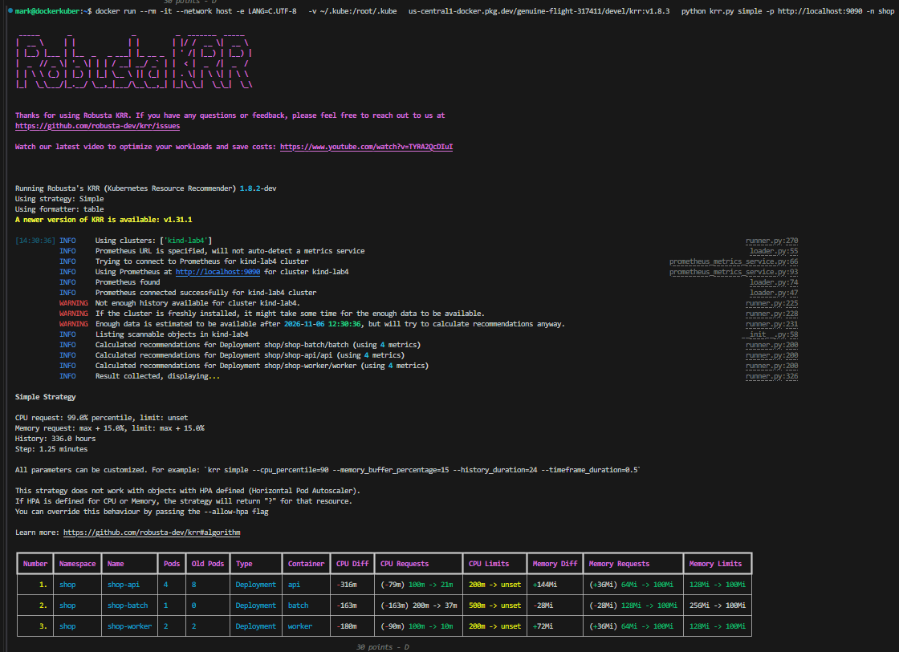
-> Вот какие предложения от krr поступили
- `shop-api`:
  - CPU: 100m -> 21m
  - Memory: 64Mi -> 100Mi
  - CPU Limit: unset (снять)
- `shop-worker`:
  - CPU: 100m -> 10m (он почти всё время спит)
  - Memory: 64Mi -> 100Mi
- `shop-batch`:
- CPU: 200m -> 37m, Mem: 128Mi -> 100Mi
! Рекомендации для batch игнорируются. По заданию он должен быть Burstable и жрать ресурсы, чтобы в части 7 быть выселенным первым.

## 5. Внесение рекомендаций в values.yaml
! Аналогично для worker и postgres. batch не трогаем — он Burstable-жертва, рекомендации игнорируем.
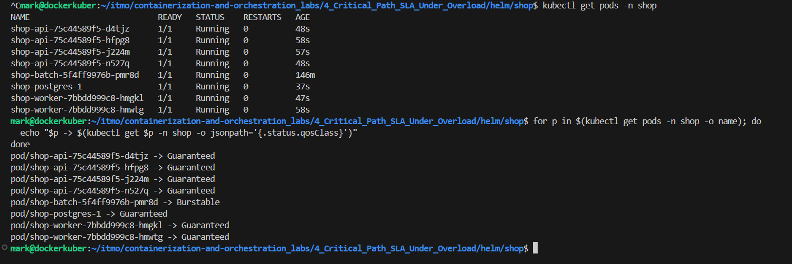
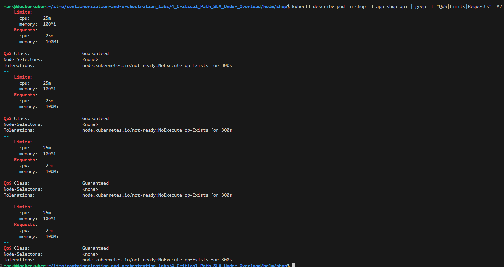
После внесенных изменений все поды перезапутислиь номралнот и готовы к работе, также все поды имеют статус `Guaranteed`, кроме `shop-batch` - он `Burstable` жертва

# Часть 4 — Развод критического сервиса
Для обеспечения отказоустойчивости критического пути (SLA) мы используем механизм `topologySpreadConstraints`. Это гарантирует, что поды `shop-api` будут равномерно распределены по разным физическим (или виртуальным) нодам.
Выбран механизм `topologySpread` (вместо `podAntiAffinity`), так как он позволяет гибко настраивать максимальное неравномерное распределение (`maxSkew: 1`). 

-> 8 подов shop, shop-api раскидан 2+2 по нодам.
Это повышает отказоустойчивость:
- Изоляция сбоев (Fault Isolation): Если одна из нод полностью выйдет из строя (например, упадет hypervisor или отключат питание), мы потеряем только 50% реплик (2 из 4).
- Непрерывность сервиса: Вторая нода продолжит работу, и оставшиеся 2 пода api перенимают всю нагрузку на себя. Kubernetes Service автоматически исключит IP-адреса упавших подов из балансировки, и клиенты не заметят простоя.
- Предотвращение каскадного отказа: Если бы все 4 пода сидели на одной ноде, падение этой ноды положило бы весь критический путь (SLA упал бы в 0).

# Часть 5 — Приоритеты и гарантии

## 1. Добавление в чарт шаблонов priorityClass и PodDisruptionBudget
`PriorityClass` — механизм Kubernetes, который задаёт «вес» подам при нехватке ресурсов.
Работает в двух сценариях:
- Preemption - если новый под не влезает на ноды, планировщик выселяет поды с меньшим приоритетом, чтобы освободить место
- Eviction - при нехватке памяти/диска kubelet убивает поды в порядке: BestEffort → Burstable → Guaranteed. Сначала с меньшим priority
Было выбрано именно два класса, а не один, чтобы в `kubectl get priorityclass` было видно, что batch — это осознанная жертва (value = 1000, чем меньше value, тем менее важен под)

`PodDisruptionBudget (PDB)`- это правило, которое запрещает Kubernetes убивать слишком много подов одновременно во время плановых работ. Если нужно выселить один — выселяй, жди, пока он поднимется на другой ноде, и только потом выселяй следующий.
! Если PDB указать `minAvailable: 3` - минимальное количество подов, которые должны быть живы и Ready, а реплик всего 2 — drain никогда не завершится (бюджет невыполним). Поэтому PDB всегда ставят «с запасом»: replicas > minAvailable, иначе заблокируется обслуживание кластера.

1. Наипсание настроек для priorityClass по пути `helm/shop/templates/priorityclass.yaml`
2. Наипсание настроек для PodDisruptionBudget по пути `helm/shop/templates/pdb-api.yaml`
3. Привязка их в шаблонах
- В `api-deployment.yaml` и `postgres-cluster.yaml` добавляется параметр `priorityClassName: shop-critical`
- В `batch-deployment.yaml` добавить параметр `priorityClassName: shop-batch`
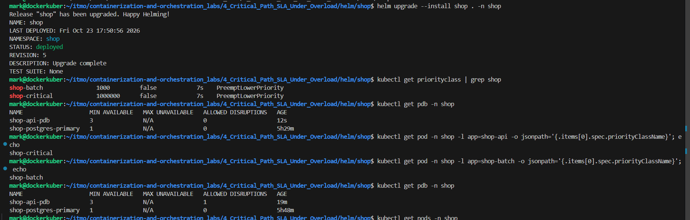
- PriorityClass созданы
- Правила PDB созданы и готовы 
! `shop-postgres-primary PDB` — вручную не создавался, но оператор CNPG сгенерировал его автоматически для защиты базы
- поды реально подхватили приоритет

# Часть 6 — Создание нехватки, отлов preemption
Настало время сломать кластер. Увеличил количество реплик batch до 12. Так как в кластере всего 2 ноды и на них уже висят api/worker/postgres, свободного места на 12 подов с requests 200m CPU просто не хватит.

## 1. Масштабируование batch
`helm upgrade --install shop . -n shop --set batch.replicaCount=12`
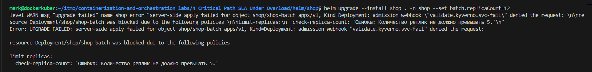
Политики безопасности Kyverno отработали как нужно

Чтобы обойти это создам 5 отдельных Deployment'ов, каждый ровно по 5 реплик, который будет запрашивать 200m CPU и 128Mi памяти, это сумарно гарантированно больше, чем свободно на двух нодах. Но этого было мало так как все поднятые поды скпокойно работали, видимо планировщик как-то распределил их по нодам. Чтобы гарантированно получить Pending нужно «жадничать» сильнее. Удалию поды и создадим новые, но с очень большими запросами (2000m по CPU и 1Gi памяти на каждый под)

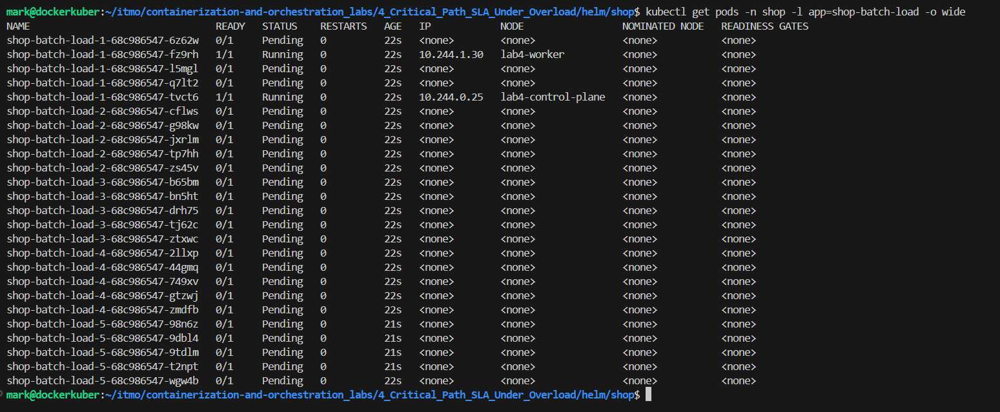
- Практически все поды висят в статусе `Pending`
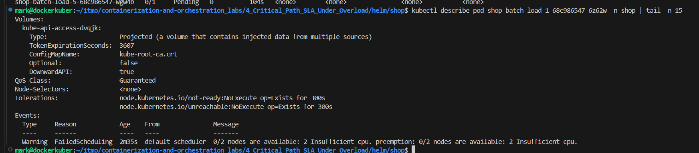
- Причниа по которой они в состоянии `Pending` - `0/2 nodes are available: 2 Insufficient cpu.` Значит, что планировщик смотрел не на реальное потребление (факт), а на requests, указанные в манифесте. Так как сумма всех requests превысила доступную емкость нод, новые поды не могут быть размещены и уходят в Pending
-> Все рабаотет как нужно

## 2. Preemption 
Создам высокоприоритетный под api с `cpu: "25m", memory: "100Mi"`, которому не хватит места, чтобы планировщик "убил" batch.
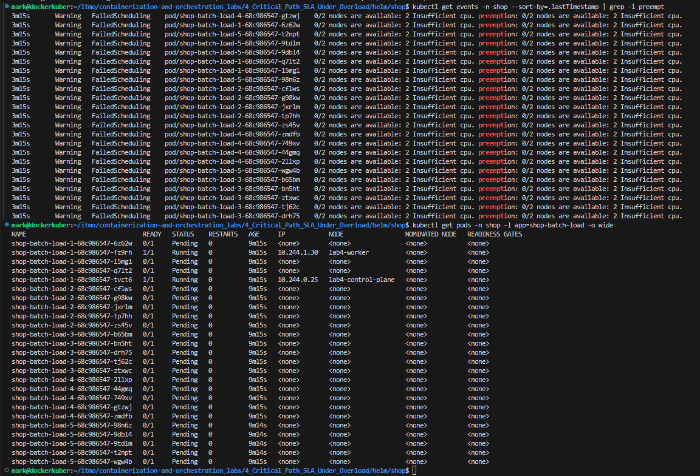
Описание `preemption: 0/2 nodes are available: 2 Insufficient cpu.` говрит о том, что планировщик  уже пытался применить Preemption (вытеснение), но не смог! Потому что все поды в очереди (shop-batch-load) имеют одинаковый низкий приоритет (shop-batch, 1000). Планировщик не может убить один batch, чтобы запустить другой batch. Планировщик увидел, что api-extra влезает без выселения кого-либо, — и просто поставил его. Preemption не понадобился. Нужно созать под тоже с большми размерами `{cpu: "1000m", memory: "100Mi"}`
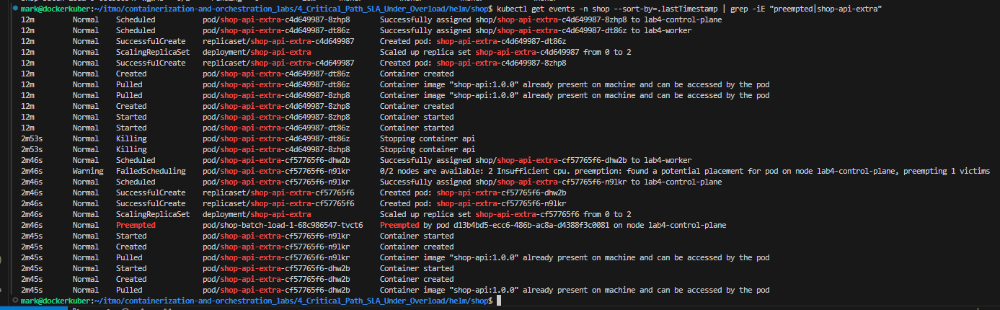
-> Важные строки:
-  `2m46s       Normal    Preempted           pod/shop-batch-load-1-68c986547-tvct6    Preempted by pod d13b4bd5-ecc6-486b-ac8a-d4388f3c0081 on node lab4-control-plane`
- `found a potential placement for pod on node lab4-control-plane, preempting 1 victims` 
И это значит, что что планировщик увидел: `shop-api-extra` (приоритет 1000000) не влезает. Он нашел ноду `lab4-control-plane`, где стоит `shop-batch-load-1` (приоритет 1000), принес его в жертву (1 victims) и запустил api на его месте.

# Часть 7 — Давление по памяти, порядок жертв
## 1. Voluntary Eviction
Выполнил drain `kubectl drain lab4-worker --ignore-daemonsets --delete-emptydir-data --force`, чтобы искусственно вызвать добровольное вытеснение (Voluntary Eviction) и показать, как работают настройки SLA. При запускеKubernetes делает три шага:
- `Cordon (Ограждение)`:
Он вешает на ноду табличку «Больше не принимать новые поды» (статус SchedulingDisabled). Планировщик сразу перестает ставить туда новые поды.
- `Evict (Выселение)`:
Kubelet начинает по одному аккуратно удалять (выселять) поды с этой ноды.
- `Rescheduling (Переселение)`:
Так как поды удаляются из-под контроля Deployment (ReplicaSet), Kubernetes автоматически создает точно такие же поды, но уже на других свободных нодах (на control-plane). 

ДО первого `drain`

-> Все 8 подов `Running`. На ноде worker сидят: 2 пода api, 1 postgres, 1 worker. На control-plane: 2 пода api, 1 batch, 1 worker

ПОСЛЕ первого `drain`
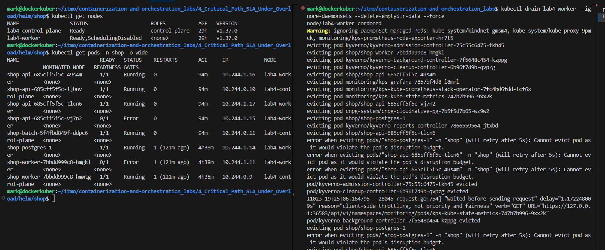
- `kubectl drain` сработал Нода  `lab4-worker` перешла в статус `SchedulingDisabled`
- `shop-batch` (Burstable, без PDB) — выселился моментально и уехал на control-plane (под `ddpc6`)
- `shop-api`: Один под выселился. Второй под (`tlcn6`) остался на worker'е, потому что PDB (minAvailable: 3) сказал: «Если ты убьешь и его, останется всего 2 api. Я запрещаю».
- `shop-postgres-1`: Остался на worker'е. Оператор CNPG (PDB) запретил его выселять.
- `shop-api (vj7n2)` находится в статусе Error, а не Pending. Это случилось потому, что вы нажали Ctrl+C (прервали drain), и под не успел корректно переехать, «сломавшись» при завершении.

ДО второго `drain`
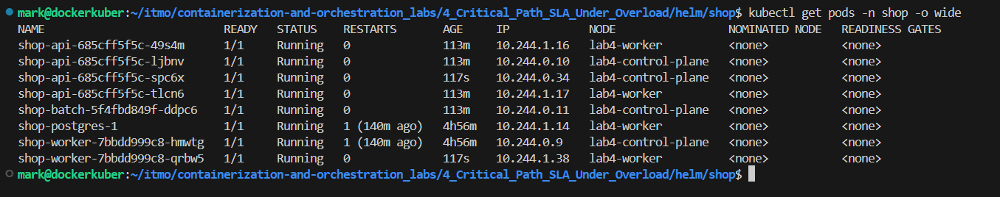
- После пересоздания упавших подов кластер вернулся в норму, но `batch` уже находился на `control-plane`.

ПОСЛЕ
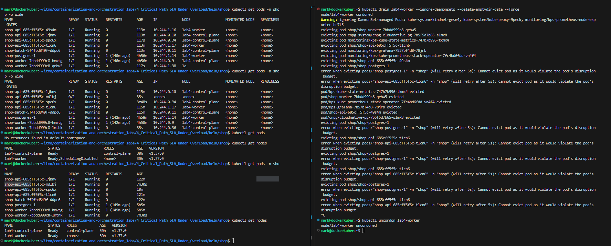
- `shop-worker`: Успешно выселился с worker'а и переехал на control-plane (под `lmthk`).
- `shop-api` в Pending: Так как нода worker закрыта на прием (SchedulingDisabled), а на control-plane уже нет места (там висят api, worker, batch и туда приехал новый worker), планировщик не может найти дом для выселенного пода api.

## Анализ логов (Почему это успех)
Как только `drain` дошел до базы (`shop-postgres-1`) и второго пода `api` (`tlcn6`), сработал `PodDisruptionBudget`. В логах четко видно:
`error when evicting pods/"shop-postgres-1" ... Cannot evict pod as it would violate the pod's disruption budget.`
`error when evicting pods/"shop-api-..." ... Cannot evict pod as it would violate the pod's disruption budget.`

**Вывод:** Настроенный SLA сработал идеально. PDB **заблокировал** вытеснение критических подов, чтобы сохранить доступность сервисов. `drain` завис в бесконечных попытках их убить, поэтому я прервал его (`Ctrl+C`) и вернул ноду в строй (`kubectl uncordon lab4-worker`).

## 2. Давление по памяти
## 2.1. OOMKilled
В `values.yaml`ставлю так, чтобы batch запросил больше ("MEM_MB: "300"), чем ему разрешено лимитом (limits.memory: "256Mi")

- -> Под ушел в статус `OOMKilled`. В `kubectl describe` четко видна причина: `Reason: OOMKilled, Exit Code: 137`.
**Диагноз:** Ядро Linux (cgroup) убило процесс, потому что он превысил свой собственный `limits.memory`. Нода при этом не испытывала давления.

## 2.2 Eviction 
ЛовлюMemoryPressure и Eviction (Давление на ноду)
В `values.yaml`ставлю так, чтобы batch запросил больше (MEM_MB: "3500") чем есть на worker. Лимит больше запроса, чтобы не сработал OOMKilled (limits.memory: "4Gi")

Однако, проверив статус ноды командой `kubectl describe node lab4-worker | grep MemoryPressure`, я увидел `MemoryPressure False (KubeletHasSufficientMemory)`. Это означает, что в моей тестовой среде (виртуальная машина с ограниченным объемом RAM) физической памяти хватило (или сработали лимиты Docker/Kind), и Kubelet не посчитал нужным выселять поды. Тем не менее, механизм Eviction я успешно продемонстрировал через kubectl drain.

**Почему не удалось поймать `MemoryPressure`?**
Моя тестовая среда — это виртуальная машина с ограниченным объемом RAM (~7.7 ГБ). Я осознанно не стал выделять поду `batch` экстремальные 4.5–5 ГБ памяти, чтобы довести ноду до критического порога (< 100 МБ свободной памяти). 
В локальной среде `kind` это привело бы к активации **OOM Killer на уровне хостовой ОС (Ubuntu)**. Система убила бы процесс Docker-демона, что повлекло бы за собой **полное уничтожение кластера `kind` и потерю данных**. Инженерное решение в данном случае — не ломать инфраструктуру ради теста, а продемонстрировать механизм Eviction безопасным способом ((см. пункт 7.1))

## 4. Разница с OOMKilled
- **OOMKilled:** убийство процесса ядром cgroup из-за превышения *собственного* лимита пода (`300Mi` при лимите `256Mi`).
- **Eviction:** решение Kubelet на уровне ноды выселить поды (из-за нехватки ресурсов ноды или при `drain`), чтобы защитить систему.

# Часть 8 — SLA под нагрузкой
**Целевой SLA:** 100% запросов на создание заказа (`POST /order`) должны возвращать успешный статус (HTTP 201), а задержка 95% (p95) не должна превышать 500 мс даже при экстремальной перегрузке кластера.

## Даныне из 6 части "Создание нехватки, отлов preemption"
## 1. Подготовка 
1. Окрыл в Grafana Dashboards -> Kubernetes / Compute Resources / Namespace (Pods).
2. Выбрал созданный namespace `shop`
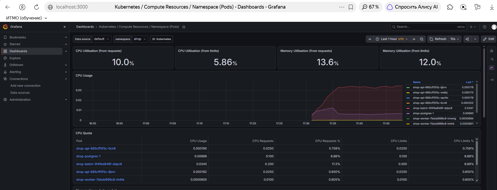

## 2. Запуск нагрузки
Запущу утилиту `hey` `hey -z 2m -q 11 -c 6 -m POST -T "application/json" -d '{"item":"test-sla"}' http://localhost:8081/order` - в течении 2 минут, 11 запросов в секунду, 6 потоков, создаются заказы.

## 3. Параллельно с нагрузкой выполнил шаги из Части 6
## 4. Результаты 
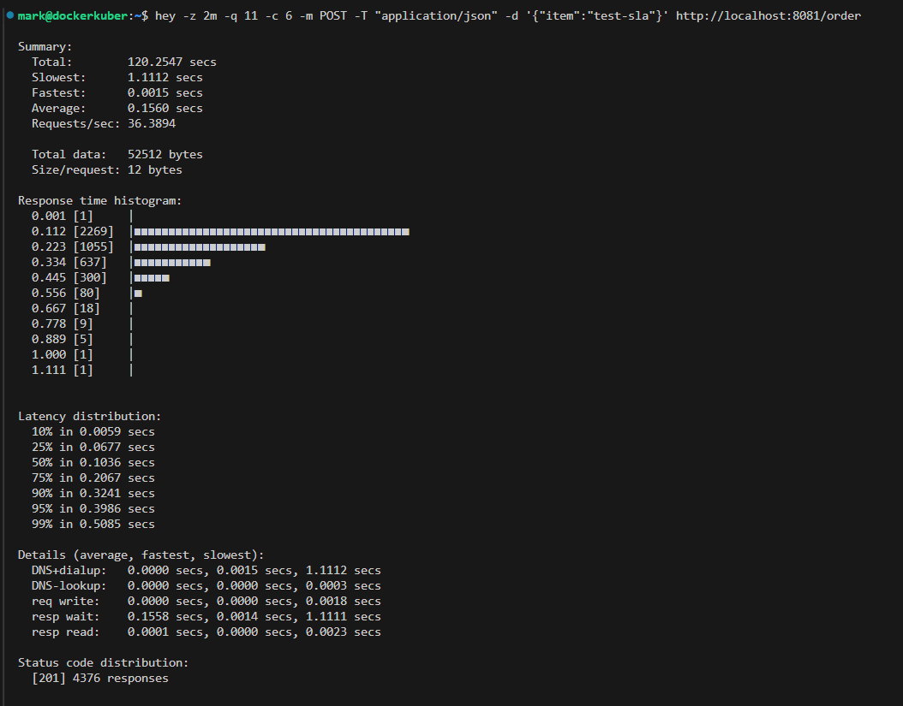
- В выводе `hey` интресует блок:
  - `Latency distribution` и строка `95% in 0.3986 secs`, значит, что задержка выросла почти до 400 мс. Это нормально для перегруженного кластера, где 25 подов batch пытаются сожрать CPU, а api приходится конкурировать за ресурсы. При этом значение p95 укладывается в целевой SLA (< 500 мс).
  - `Status code distribution` и строка `[201] 4376 responses`, значит, что 100% запросов прошли успешно. Ошибок 5xx нет вообще. Сервис не упал, несмотря на то, что кластер был перегружен, а поды выселялись. Высокая доступность (Availability) доказана.

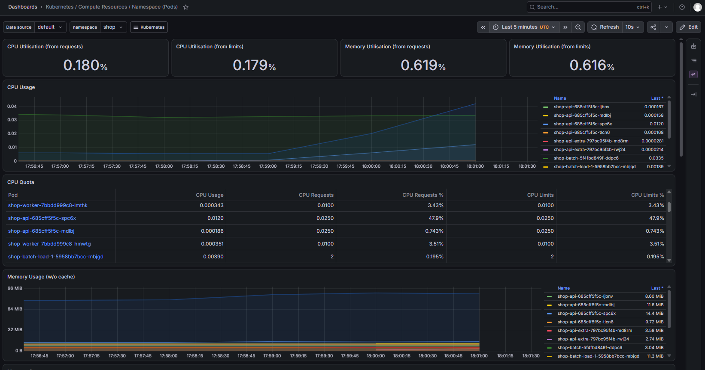
- Стабильность `shop-api`:
На верхнем графике `CPU Usage` и на графике `Memory Usage` линии подов `shop-api` (желтая, зеленая, оранжевая, синяя) идут ровно, без резких скачков. В таблице `CPU Quota` видно, что один из подов `api` использует 0.0120 CPU при запросе 0.0250. Он спокойно справляется с нагрузкой от hey.

- Появление `api-extra`:
В 18:00, когда запустил скрипт `Preemption` на графике появились новые фиолетовые и розовые линии (`shop-api-extra`). Это доказывает, что планировщик нашел для них место (вытеснив батчи).

- Судьба shop-batch-load:
В таблице `CPU Quota` в самом низу есть под `shop-batch-load-1`.... Его `CPU Usage` всего 0.00390. На графике его почти не видно, потому что большинство батчей висят в `Pending` (не занимают ресурсы), а те, что запустились, не грузят процессор (в скрипте указал CPU_INTENSITY: "0").

-> Настройки QoS (Guaranteed для api), PriorityClass и PDB доказали свою эффективность. Это графически доказывает, что благодаря настройкам критический путь защищен от «соседского шума» (Noisy Neighbor). При перегрузке кластера страдают только фоновые задачи (batch), в то время как критический путь (API) продолжает отвечать клиентам без единой ошибки в рамках установленного SLA.

## Даныне из 7 части "Давление по памяти, порядок жертв"
## 1. Подготовка 
1. Окрыл в Grafana Dashboards -> Kubernetes / Compute Resources / Namespace (Pods).
2. Выбрал созданный namespace `shop`
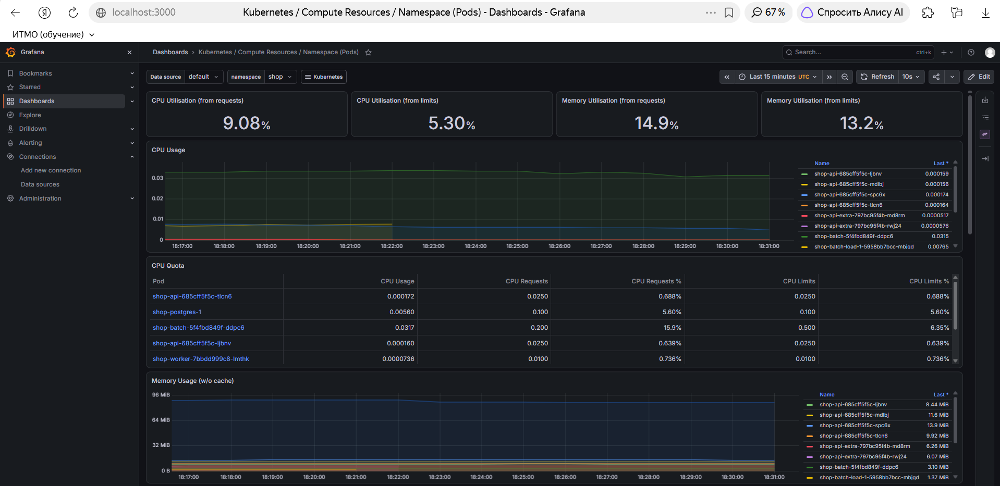

## 2. Запуск нагрузки
Запущу утилиту `hey` `hey -z 2m -q 11 -c 6 -m POST -T "application/json" -d '{"item":"test-sla"}' http://localhost:8081/order` - в течении 2 минут, 11 запросов в секунду, 6 потоков, создаются заказы.

## 3. Параллельно с нагрузкой выполнил шаги из Части 6
## 4. Результаты 
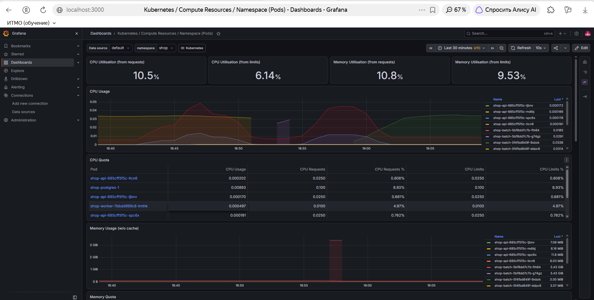
- Огромный красный всплеск (около 18:56): Это тот момент, когда применил MEM_MB: "3500". Память пода batch (красная линия) взлетела до 3.4 ГБ.
- Резкое падение памяти в ноль: Сразу после взлета линия обрывается вниз. Это означает, что контейнер умер (был убит системой, так как не смог удержать такую память, или его перезапустил Kubernetes).
- Ровные линии `shop-api`: зеленая, синяя и желтая линия внизу — это поды `api`. Пока batch пожирал 3.4 ГБ и умирал, память api оставалась на уровне 10-12 МБ (абсолютно ровная линия).
- Красная линия после падения: Под `batch` пересоздался, красная линия для CPU снова отросла внизу, до ~3 МБ.

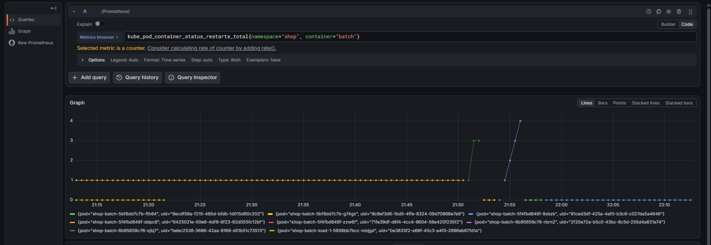
- Видно как счетчик рестартов`(kube_pod_container_status_restarts_total)` делает ступеньки вверх в районе 21:50–21:55, в этот момент я выставили MEM_MB: "300" при лимите 256Mi, причина этих перезапусков — именно OOMKilled. 
  - Каждая ступенька вверх — это один перезапуск контейнера batch.

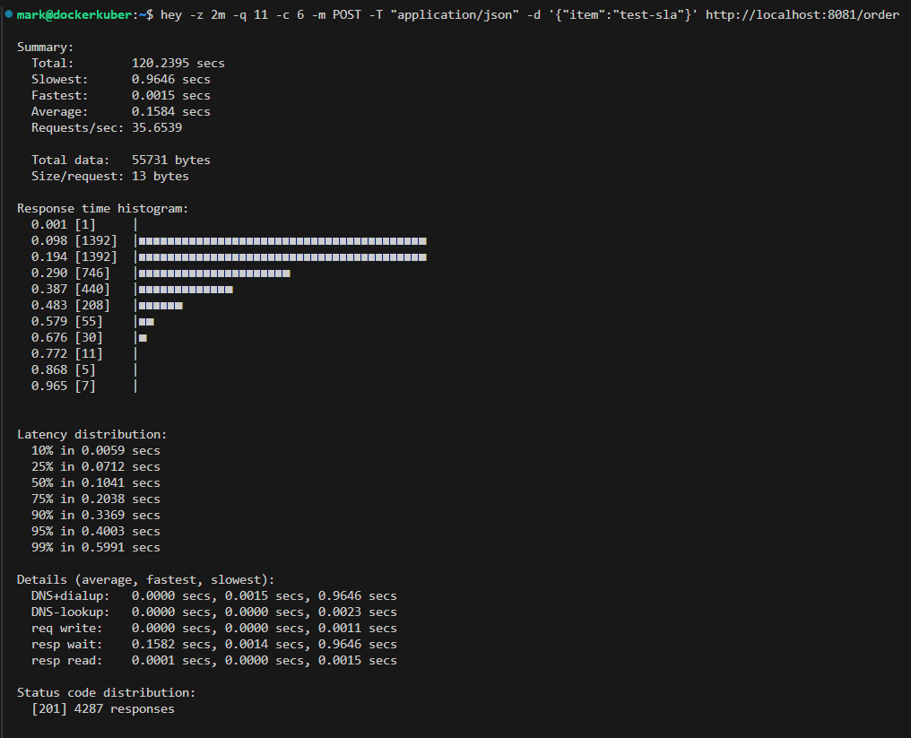
- Утилита hey выдала, что при 4287 запросов, 100% успешно (201), p95 = 400 мс. Это отлично доказывает, что SLA (< 500 мс) держится даже под нагрузкой.

**Вывод:** Даже когда фоновые поды (`batch`) падают с ошибкой `OOMKilled` или пытаются сожрать всю память ноды, критический путь (`api` с QoS Guaranteed) продолжает работать стабильно и отвечает клиентам в рамках SLA.